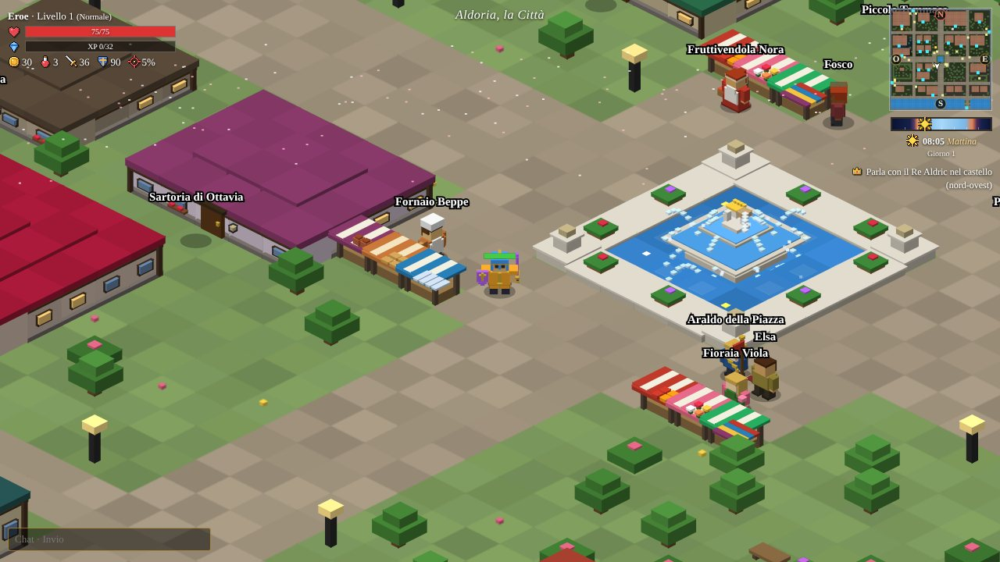
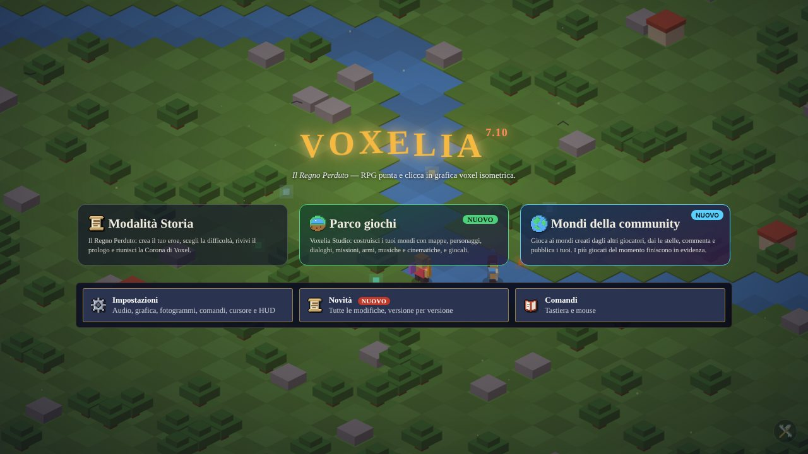
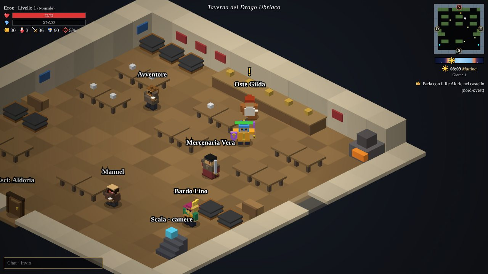
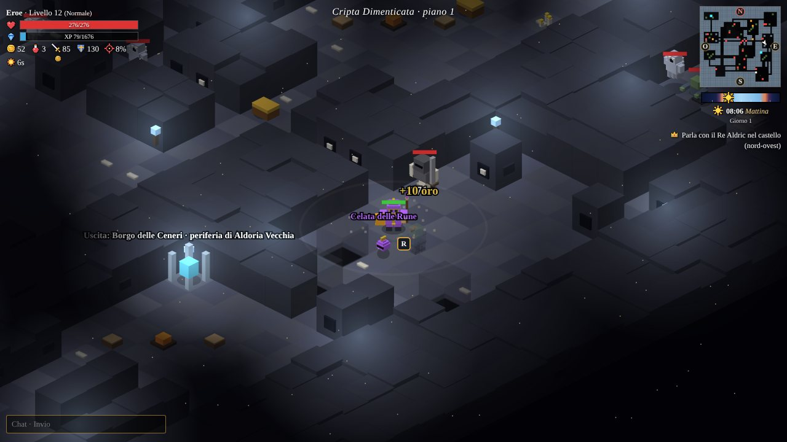
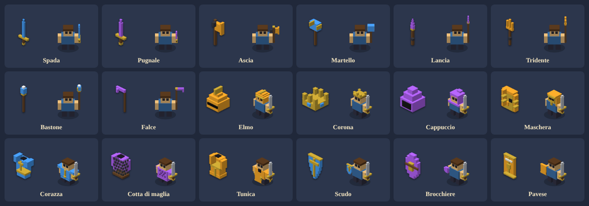
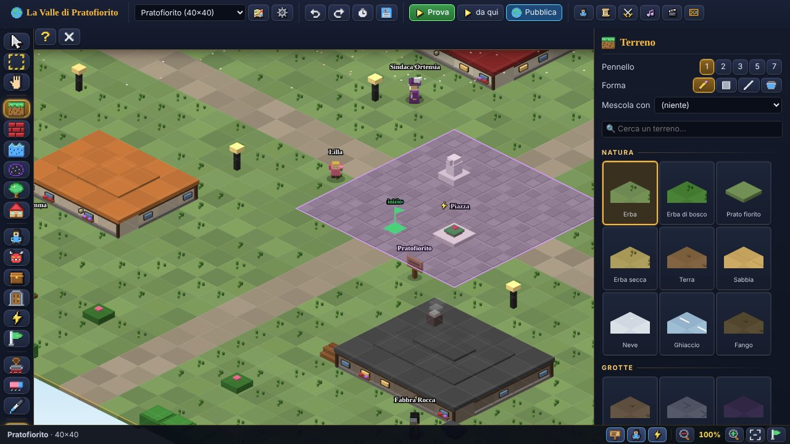

# Voxelia – Il Regno Perduto

**Un gioco di ruolo punta e clicca in grafica voxel isometrica, che gira nel browser.** Si gioca da soli o con gli amici, si
esplora la città di Aldoria e il regno intorno, si combatte nei dungeon e si costruiscono mondi propri con l'editor
**Voxelia Studio**.

Versione attuale: **7.13.3** · tutte le modifiche, versione per versione, sono in [CHANGELOG.md](CHANGELOG.md) (anche nel
gioco, nel menu **Novità**).



> *Il Re Lich Malakar ha spezzato la Corona di Voxel in sei frammenti. Esplora Aldoria, accetta missioni, conquista sette
> dungeon che rinascono a ogni vittoria e sfida gli altri eroi nel Colosseo.*

---

## Indice

- [In breve](#in-breve)
- [Come si gioca subito](#come-si-gioca-subito)
- [Comandi](#comandi)
- [Le modalità](#le-modalità)
- [La Modalità Storia](#la-modalità-storia)
- [Il mondo](#il-mondo)
- [L'eroe e l'equipaggiamento](#leroe-e-lequipaggiamento)
- [Cose da fare ad Aldoria](#cose-da-fare-ad-aldoria)
- [Musica](#musica)
- [Voxelia Studio](#voxelia-studio)
- [Mondi della community](#mondi-della-community)
- [Multigiocatore: il server](#multigiocatore-il-server)
- [Plugin del server](#plugin-del-server)
- [Pubblicare il server online](#pubblicare-il-server-online)
- [Impostazioni, lingue e salvataggi](#impostazioni-lingue-e-salvataggi)
- [Struttura del progetto](#struttura-del-progetto)
- [Sviluppo](#sviluppo)

---

## In breve

- **Un solo file.** Il gioco intero è `voxelia.html`: grafica, musica, testi e logica. Non servono installazioni,
  librerie o connessione a internet per giocare da soli.
- **Grafica voxel isometrica** disegnata in tempo reale su canvas, con giorno e notte, luci, meteo e particelle,
  e qualità regolabile da «leggera» a «Ultra».
- **Musica procedurale e scritta nota per nota**: 57 brani scritti a mano, fra cui uno diverso per ogni edificio di
  Aldoria, suonati in tempo reale dal sintetizzatore del gioco (Web Audio).
- **Un regno grande**: 102 zone (70 interni da esplorare), 7 dungeon a più piani, 173 personaggi, 130 missioni,
  71 tipi di nemici di cui 13 boss.
- **Una storia raccontata da filmati** girati nei luoghi veri del gioco, con i suoi personaggi e l'eroe vestito con il
  suo equipaggiamento.
- **Multigiocatore** con un server Node.js **senza dipendenze**: stanze, chat, scambi, arena PvP con classifica,
  pannello admin e plugin.
- **Voxelia Studio**: un editor completo per creare mondi con mappe, personaggi, dialoghi, missioni, oggetti, musiche
  e cinematiche, e **pubblicarli** sul server per farli giocare agli altri.
- **Telefoni e tablet**: joystick e pulsanti sullo schermo, che si adattano da soli al dispositivo.
- Tutto in **italiano**, con l'interfaccia anche in inglese e in eldoriano, la lingua antica del regno.

---

## Come si gioca subito

### Da soli, nel browser
1. Scarica o apri `voxelia.html` con un browser recente (Chrome, Edge, Firefox, Safari).
2. Nel menu scegli **Modalità Storia**, crea l'eroe e scegli la difficoltà.

La partita si salva da sola nel browser. Funziona anche offline.

### Con gli amici, sulla stessa rete
Serve [Node.js](https://nodejs.org) 16 o più recente:

```sh
node server.js
```

Il server chiede la password del pannello admin, oppure la legge da `ADMIN_PASSWORD`. Poi stampa gli indirizzi da aprire,
per esempio `http://192.168.1.20:3000`. Chi apre quell'indirizzo gioca con il server. Gli eroi che scrivono lo **stesso
codice stanza** nel menu (campo «Stanza») giocano insieme. Lasciando il campo vuoto si gioca da soli.

Per giocare con amici su reti diverse si espone la porta con un tunnel (per esempio cloudflared o ngrok), oppure si
pubblica il server online: vedi [Pubblicare il server online](#pubblicare-il-server-online).

---

## Comandi

### Tastiera e mouse

| Tasto | Azione |
|---|---|
| Clic sul terreno, **W A S D** o frecce | Muoversi |
| Clic su nemici, forzieri, oggetti, personaggi | Attaccare, aprire, raccogliere, parlare |
| **R** | Interagire con ciò che hai vicino |
| **Spazio** | Colpo ad area |
| **Shift** o **E** | Schivata |
| **F** | Affondo (diverso per ogni tipo di arma) |
| **1 2 3 4** | Abilità delle arti marziali |
| **Q** | Bere una pozione |
| **I** | Zaino |
| **J** | Missioni |
| **K** | Diario |
| **L** | Classifica |
| **P** | Giocatori |
| **M** | Mappa di Aldoria |
| **C** | Aspetto dell'eroe |
| **O** | Opzioni |
| **V** | Ruota delle azioni (il tasto si può cambiare) |
| **Invio** | Chat |
| **Esc** | Chiude la finestra aperta |
| Rotella del mouse | Zoom |

Ogni tasto delle finestre le apre e le chiude. Si apre una finestra alla volta: aprendone una si chiudono le altre.

### Telefoni e tablet
Sui dispositivi touch compaiono:
- il **joystick** in basso a sinistra, che parte dal punto in cui si tocca;
- i pulsanti **Colpo**, **Affondo**, **Schiva**, **Pozione** e le abilità;
- il pulsante verde **usa**, quando c'è qualcosa vicino;
- il **Menu** a griglia con zaino, missioni, diario, mappa, aspetto, classifica, giocatori, chat e opzioni.

Lo zoom si fa con due dita. Comandi e pulsanti si adattano da soli a telefoni, pieghevoli e tablet, in verticale e in
orizzontale, e si possono spostare e ridimensionare con l'**editor dell'HUD** (Impostazioni → Interfaccia).

### Meta Quest (realtà virtuale)
Nel browser del Quest compare il pulsante **Entra in VR** (nel menu e, durante la partita, in basso a destra). Il gioco
appare su un grande schermo sospeso davanti a te; la pagina deve essere aperta da un indirizzo **https** (o da `localhost`),
altrimenti il browser non offre la realtà virtuale.

| Comando | Controller |
|---|---|
| Puntare e cliccare / scorrere una finestra | Raggio del controller + grilletto / levetta destra su e giù |
| Muoversi | Levetta sinistra |
| Zoom | Levetta destra (avanti e indietro) |
| Interagire (R) / Schivata (o chiudi finestra) | A / B |
| Pozione / Zaino | X / Y |
| Colpo ad area / Affondo | Impugnatura sinistra / destra |
| Mappa / Rimettere lo schermo davanti | Premere la levetta sinistra / destra |

#### Prima persona
Entrando in VR si gioca **in prima persona**: vedi il mondo con gli occhi dell'eroe, a grandezza naturale, costruito con gli
stessi modelli del gioco; in mano hai l'arma equipaggiata e sul braccio lo scudo. Si attacca muovendo il controller.
L'interfaccia del gioco è un pannello sotto lo sguardo, da guardare (i suoi pulsanti sono nel menu della VR); zaino, dialoghi, negozi e mappa si aprono su un pannello davanti a te.
Durante filmati, visita guidata, navigazione e minigiochi si torna da soli allo schermo sospeso.

| Comando | Controller |
|---|---|
| Attaccare | Fendente con il controller destro · grilletto destro (nemico davanti) |
| Affondo / Colpo ad area | Stoccata in avanti · impugnatura destra / le due mani giù insieme · impugnatura sinistra |
| Camminare / Girarsi | Levetta sinistra (si cammina dove guardi, o davvero nella stanza) / levetta destra |
| Interagire / Schivata o chiudi | A (con chi ti sta davanti, o con chi punti col raggio) · grilletto puntato su una persona, porta o oggetto / B |
| Pozione / Zaino / Mappa | X / Y / premere la levetta sinistra |
| Menu della VR | Grilletto sinistro puntato nel vuoto: pulsanti della barra, prima persona sì/no, rotazione a scatti o continua, vignetta (da nessuna a forte), distanza di visuale, velocità, altezza degli occhi |

---

## Le modalità



| Modalità | Che cos'è |
|---|---|
| **Modalità Storia** | Il Regno Perduto: l'avventura principale, con quattro difficoltà, il prologo e le scene della storia. |
| **Parco giochi · Voxelia Studio** | L'editor per costruire e giocare i propri mondi. |
| **Mondi della community** | I mondi pubblicati dagli altri giocatori sul server: si giocano, si votano e si commentano. |
| **Voxelia Dimension** | Un'avventura a parte attraverso le epoche (Far West, Londra vittoriana, Rivoluzione francese, Grande Guerra). Per ora è nascosta dal menu ed è raggiungibile dal pannello sviluppatore. |

---

## La Modalità Storia

Re Aldric affida all'eroe la missione di ritrovare i **sei frammenti della Corona di Voxel**, custoditi dai signori dei
dungeon. Poi c'è la **Cittadella del Vuoto**, dove aspetta il Re Lich Malakar. Aldoria nasconde anche segreti, pagine di
diario, un quartiere murato e più di un finale: il vero finale si conquista sotto Aldoria Vecchia, contro l'**Abominio**,
in una battaglia lunga e molto difficile divisa in cinque fasi (le braccia, il ventre, l'eco della Regina Elara, l'Occhio e
il cuore).

### Scene della storia
Il viaggio è raccontato da **filmati girati nei luoghi veri del gioco**: la sala del trono, la piazza, la porta ovest, il
porto, Aldoria Vecchia, la cappella, le prigioni, la fucina di Borin, i dungeon e la stanza dell'Occhio, con i loro arredi,
le luci e gli abitanti. I personaggi camminano lungo le strade, entrano in scena camminando o con una dissolvenza e
parlano con i sottotitoli. Ci sono il **prologo** (la storia della Corona dall'inizio), il giuramento, i sei ricordi dei
frammenti, la forgia della Corona, la caduta di Malakar, la festa del Campione, il settimo cuore, la verità su Aldoria
Vecchia, l'arresto, il vero finale e le scene della battaglia navale. Ogni filmato si vede una volta durante la partita
(si salta con «Salta») e poi si rivede dal menu, in **Scene della storia**.

### Difficoltà

| Difficoltà | Nemici | Bottino | Quando si cade |
|---|---|---|---|
| **Facile** | vita −30%, danni −40% | più ricco | si rinasce in città |
| **Normale** | equilibrati | normale | si rinasce in città perdendo il 15% dell'oro |
| **Difficile** | vita +50%, danni +40% | meno ricco | si rinasce in città perdendo il 25% dell'oro |
| **Incubo** | vita ×2,2, danni ×2 | povero | **morte permanente**: il salvataggio viene cancellato |

Dalla 7.11 la Modalità Storia è più impegnativa a ogni difficoltà:
- nei dungeon i nemici hanno un altro 10% (Facile), 20% (Normale) o 30% (Difficile e Incubo) di vita e di danni; fuori
  dai dungeon l'aumento è di tre quarti;
- i nemici lavorano in **branco**: chi ti vede o viene colpito chiama quelli che gli stanno vicino;
- compaiono i **Campioni**, nemici più grossi con un alone dorato ai piedi: quasi il doppio della vita, più danni, più
  velocità, e un bottino sicuro. Nei dungeon aumentano a ogni ciclo;
- i boss usano le abilità più spesso e, sotto un quarto della vita, entrano nell'**ultima furia**;
- le pozioni curano il 35% e se ne beve una ogni 2,5 secondi, l'armatura protegge un po' meno e i falò curano più piano.

I mondi di Voxelia Studio tengono l'equilibrio scelto dal loro autore.

---

## Il mondo

### Aldoria e i suoi quartieri
- **Aldoria, la città**: la piazza con la fontana e il mercato (aperto dalle 7 alle 19), il castello del Re, la biblioteca,
  la taverna, le botteghe, il tempio, il casinò, il motel, la caserma, la banca e decine di case che si possono visitare.
- **Aldoria Nord, il Quartiere Nobile**: il palazzo del Conte, il teatro dell'opera, l'osservatorio e sei ville.
- **Aldoria Est, Campi e Mestieri**: fattorie, mulino, fienile, segheria, scuderia e campi da raccogliere.
- **Porto di Aldoria**: il molo, la pescheria, il cantiere navale, il faro, i magazzini e le barche.
- **Borgo delle Ceneri**: la periferia bruciata di **Aldoria Vecchia**, con banditi, spettri e il cimitero.
- **Il Colosseo**: un vero anfiteatro con tre ordini di arcate; dentro, la sala d'ingresso e la fossa dell'arena PvP con le gradinate e la classifica.



Ogni giorno di gioco dura **24 minuti**: un secondo reale è un minuto di gioco. Di giorno i cittadini sono in giro e i
mercanti alle bancarelle. Di sera tornano a casa, di notte in strada restano le guardie di ronda, e l'esperienza vale il 20%
in più.

### Fuori dalle mura

| Zona | Livello | Boss |
|---|---|---|
| Foresta di Elmwood | 1 | Troll della Foresta |
| Deserto di Khem | 4 | Faraone Eterno |
| Picchi Gelidi | 7 | Drago di Brina |

Le tre zone sono grandi 64×64 caselle e hanno una pianta fissa, con i sentieri che dalla porta portano ai luoghi da visitare:
- **Foresta di Elmwood**: la radura delle lucciole, il cerchio di pietre con l'Erba Lunare, la capanna del Cacciatore Ulrico,
  la torre di guardia in rovina, il lago con il ruscello, l'accampamento dei goblin davanti alla Tana e la Grande Quercia del Troll.
- **Deserto di Khem**: l'oasi con la tenda del Mercante Amir, la Piramide a gradoni con la Sfinge, la città sepolta con gli
  Scarabei dorati, l'accampamento della carovana e la necropoli del Faraone.
- **Picchi Gelidi**: il rifugio dell'Esploratrice Ilva, il villaggio congelato dal Drago, il lago ghiacciato, le grotte di
  cristallo, la bocca della Fucina, il santuario con le bandierine e il covo del Drago di Brina.

### I sette dungeon
I dungeon cambiano forma a ogni discesa e **rinascono a ogni vittoria**: ogni nuovo ciclo è più forte e più ricco, e con
più **Campioni**. Nei piani ci sono forzieri, pagine di diario e **falò** dove la vita torna piano piano.

| Dungeon | Ingresso | Livello | Piani | Boss |
|---|---|---|---|---|
| Tana dei Goblin | Foresta di Elmwood | 2 | 2 | Re Goblin Grugnak |
| Cripta Dimenticata | Borgo delle Ceneri | 4 | 3 | Necromante Velka |
| Piramide di Khem | Deserto di Khem | 6 | 3 | Sfinge Antica |
| Caverne di Cristallo | Picchi Gelidi | 8 | 3 | Regina dei Ragni |
| Fucina Infernale | Picchi Gelidi | 10 | 3 | Signore della Fiamma Ignis |
| Abisso Sommerso | Porto (pozzo delle alghe) | 12 | 3 | Leviatano |
| Cittadella del Vuoto | Castello di Aldoria | 15 | 4 | Re Lich Malakar |

Ogni boss ha il suo stile: carica, terremoto, pioggia di colpi, esplosioni, teletrasporto, rigenerazione, scudo,
rinforzi. Quando si infuria diventa più veloce, e sotto un quarto della vita entra nell'**ultima furia**: attacca ancora di
più e usa un'abilità ogni tre o quattro secondi.



### Il mare e le battaglie
- **Battaglia navale** contro la *Vedova Nera* del Capitano Scarlatto: cannonate, arrembaggio e stiva.
- **La Puledra**, la barca di Stefano: cinque posti di pesca in mare aperto.
- **I campi di battaglia di Ryan il Pelato**: cinque battaglie in cui si comanda un esercito (fanti, lancieri, arcieri,
  cavalieri, catapulte), si scelgono corsia e ordini e si distrugge l'accampamento nemico. Le truppe aggirano gli ostacoli
  da sole, anche quando nascono accanto alla base.

---

## L'eroe e l'equipaggiamento

- **Aspetto** (tasto C): pelle, capelli, occhi, barba, tunica, pantaloni, mantello e corporatura. L'elmo si può nascondere.
- **Statistiche**: attacco, difesa, critico e vita, che crescono con il livello e l'equipaggiamento.
- **Quattro posti**: arma, elmo, corazza e scudo. Ogni oggetto si vede addosso all'eroe con il suo modello, lo stesso delle
  icone dello zaino.



| Posto | Tipi |
|---|---|
| Arma | spada, pugnale, stocco, ascia, martello, lancia, tridente, bastone, falce |
| Elmo | elmo, celata, corona, cappuccio, maschera |
| Corazza | corazza a piastre, giaco e cotta di maglia, tunica |
| Scudo | scudo, brocchiere, pavese |

- **Rarità**: Comune, Raro, Epico, Leggendario e Arena. I boss lasciano anche **oggetti unici** come la Clava del Troll, la
  Maschera del Faraone e la Falce di Malakar.
- **Fucina di Borin**: compra set completi, forgia oggetti rari ed epici e **potenzia** l'equipaggiamento fino a **+5**.
- **Maestria delle armi**: l'arma che usi cresce combattendo, fino a ★10 (+4% di danno per livello).
- **Affondo** (tasto F), diverso per ogni arma:

| Arma | Affondo | Portata | Ricarica |
|---|---|---|---|
| Pugnale | Fendente rapido | 2,4 | 4,5 s |
| Spada | Affondo | 2,8 | 6 s |
| Stocco | Affondo di stocco | 3,4 | 6 s |
| Lancia e tridente | Stoccata | 4 | 7 s |
| Ascia | Fendente | 2,2 | 8 s |
| Martello e clava | Schianto | 2,2 | 9,5 s |
| Bastone | Colpo di bastone | 3 | 6 s |
| Falce | Falciata | 2,6 | 7 s |

- **Arti marziali** del Maestro Dino, in caserma (tasti 1–4): **Palmo del Drago** (livello 3), **Calcio del Tornado**
  (livello 5), **Passo dell'Ombra** (livello 8), **Respiro della Tigre** (livello 10).
- **Zaini**: da 24 posti fino a 48 (Zaino da viaggio, da esploratore e del Mercante Reale). Gli oggetti si possono
  bloccare, gettare a terra, vendere o distruggere.
- **Pozioni** (tasto Q): ognuna ridà il 35% della vita, e tra un sorso e l'altro passano 2,5 secondi. Si comprano
  dall'Erborista.

---

## Cose da fare ad Aldoria

- **130 missioni** di molti tipi: caccia, raccolta, boss, consegne, pesca, raccolto, battaglie. I punti esclamativi
  gialli indicano chi ne ha una.
- **Pesca**: 25 specie, dal molo e dalla barca. Le prede si vendono o servono per le missioni.
- **Raccolta**: grano, legna, mele, uova, rose, cimeli antichi, conchiglie, Erba Lunare, Scarabei dorati e Fiori di ghiaccio, che ricrescono col tempo.
- **Casinò Fortuna d'Oro**: slot machine, dadi, roulette e blackjack.
- **Motel della Rosa dei Venti**: una stanza in affitto con il baule e il letto per dormire fino al mattino… e per sognare.
- **Diario** (tasto K): le pagine ritrovate, la storia, i luoghi e le missioni completate.
- **Mappa** (tasto M): in città la mappa di Aldoria, fuori la pianta della zona in cui ti trovi (con uscite, personaggi, boss e forzieri); una guida ai luoghi, con temi chiaro e scuro.
- **Prezzi del giorno**: nei negozi cambiano a ogni mezzanotte del gioco.

---

## Musica

Tutta la musica è generata in tempo reale dal sintetizzatore del gioco:
- **57 brani scritti** nota per nota, ognuno con melodia, accordi, basso, accompagnamento e batteria;
- **brani procedurali** per le zone speciali.

Ogni zona ha il suo tema, e dalla 7.10 anche **ogni edificio** ha il suo brano a tema. La taverna balla una giga, la
fucina batte sull'incudine, il tempio canta in coro, il faro suona sopra le onde. Gli strumenti sono 19 (flauto, ottoni,
archi, arpa celtica, organo, carillon, liuto, clavicembalo, fisarmonica, zufolo, coro, violino, banjo e altri), con
riverbero, eco e batterie diverse per ogni stile.

---

## Voxelia Studio



Il **Parco giochi** è un editor completo per creare avventure con gli stessi blocchi, arredi, personaggi, nemici e musiche
del gioco, provarle al volo (**▶ Prova**) e giocarle dall'inizio alla fine.

- **Mappe** da 16×16 a 96×96, collegate da porte, con 14 modelli di partenza: prato, bosco, isola, grotta, dungeon,
  villaggio, deserto, neve, labirinto e altri. Per ogni mappa si scelgono cielo, luce, liquidi, particelle e musica.
- **Strumenti**: terreno, muri, acqua e lava, decorazioni e arredi, edifici con interno creato con un clic, personaggi,
  nemici, oggetti, porte, zone evento. Ci sono pennelli e forme, annulla e rifai, e il salvataggio automatico.
- **Personaggi** con aspetto completo, dialoghi a nodi con condizioni e azioni, mestieri (mercante, fabbro, locandiere…),
  passeggiate, ronde e compagni che seguono l'eroe.
- **Missioni** con 9 tipi di passo, ricompense, condizioni e ripetibilità.
- **Oggetti e armi** su tutte le basi del gioco, con rarità ed effetti speciali (fuoco, gelo, vampiro, fulmine, veleno,
  spinta).
- **Eventi**: zone evento, variabili, 9 tipi di condizione e 26 azioni (messaggi, oro, oggetti, missioni, teletrasporto,
  cinematiche, musica, nemici, vittoria, sconfitta…).
- **Compositore di brani**: melodia a note, scale, strumenti, bassi, accompagnamenti e batterie, anche personalizzate.
- **Cinematiche** con inquadrature, battute, movimenti e musica.
- **Controllo del mondo** (🩺): trova porte senza destinazione, missioni impossibili, oggetti irraggiungibili.
- I mondi si salvano nel browser e si **esportano** in un file `.voxelia.json` da regalare o importare. C'è anche un
  **mondo di esempio**, «La Valle di Pratofiorito», da giocare o studiare.

---

## Mondi della community

Con un server, i mondi creati con Voxelia Studio si **pubblicano** (pulsante **Pubblica** nell'editor) e compaiono nel
**browser dei mondi**:
- una prima pagina con i mondi **in evidenza** (quelli che ricevono tante partite e recensioni in poco tempo);
- le sezioni di tendenza, appena pubblicati, più votati e più giocati;
- ricerca e filtri per genere;
- schede con galleria di immagini e video, statistiche, stelle, recensioni e commenti.

Gli amministratori possono nascondere mondi, rispondere alle segnalazioni e bloccare gli autori dal pannello admin.

---

## Multigiocatore: il server

`server.js` è un solo file per Node.js 16+ **senza dipendenze npm**. Fa queste cose:
- serve il gioco (il file `voxelia*.html` più recente nella sua cartella) e il pannello admin;
- tiene le **stanze**: chi scrive lo stesso codice gioca insieme e si vede nel mondo, con il proprio aspetto e
  l'equipaggiamento;
- gestisce **chat** (con i link cliccabili, che si aprono in una nuova finestra), **scambi** tra giocatori e oggetti a terra condivisi;
- gestisce l'**arena PvP** nel Colosseo, con vittorie verificate dal server, punti arena e il **negozio dell'arena**;
- tiene la **classifica** e i **cicli dei dungeon** condivisi, e un **orologio del mondo** uguale per tutti;
- raccoglie i **Mondi della community**: pubblicazione, recensioni, commenti e segnalazioni;
- carica i **plugin**.

### Variabili d'ambiente

| Variabile | Predefinito | A cosa serve |
|---|---|---|
| `PORT` | `3000` | Porta HTTP e WebSocket |
| `TLS_CERT` / `TLS_KEY` | (nessuno) | Percorsi di certificato e chiave PEM. Se ci sono entrambi il server parla **https** e i WebSocket passano in **wss** sulla stessa porta. |
| `ADMIN_PASSWORD` | (chiesta all'avvio) | Password del pannello admin. Se manca e non c'è un terminale, ne viene generata una casuale e stampata nel registro. |
| `DATA_FILE` | `voxelia-data.json` | Classifica, punti arena, cicli dei dungeon, impostazioni, ban, dati dei plugin |
| `MONDI_DIR` | `mondi/` | Cartella dei mondi pubblicati |
| `PLUGINS_DIR` | `plugins/` | Cartella dei plugin |

### Giocare dal Meta Quest
Il browser del Quest offre la realtà virtuale solo su pagine **https** o su `localhost`, e il gioco si collega al
WebSocket con lo stesso protocollo della pagina (`wss://` da https). Con il server in `http` sulla rete di casa il gioco
si apre, ma il pulsante **Entra in VR** non compare. Ci sono tre strade:

1. **Server online o tunnel** (la più semplice). Sul server pubblicato (vedi [Pubblicare il server online](#pubblicare-il-server-online))
   l'https c'è già. In casa basta un tunnel verso la porta 3000, poi si apre sul Quest l'indirizzo `https://` che stampa:
   ```sh
   cloudflared tunnel --url http://localhost:3000
   # oppure: ngrok http 3000
   ```
2. **HTTPS dal server, in rete locale.** Crea un certificato per l'indirizzo del PC (quello stampato all'avvio, ad
   esempio `192.168.1.20`) e avvia il server con `TLS_CERT` e `TLS_KEY`:
   ```sh
   # con mkcert (certificato riconosciuto dai browser del PC dove è installata la sua CA)
   mkcert 192.168.1.20 localhost
   TLS_CERT=192.168.1.20+1.pem TLS_KEY=192.168.1.20+1-key.pem node server.js
   # oppure autofirmato con openssl
   openssl req -x509 -newkey rsa:2048 -nodes -days 365 -keyout key.pem -out cert.pem \
     -subj /CN=192.168.1.20 -addext "subjectAltName=IP:192.168.1.20,DNS:localhost"
   TLS_CERT=cert.pem TLS_KEY=key.pem node server.js
   ```
   Sul Quest apri `https://192.168.1.20:3000`: il browser avvisa che il certificato non è attendibile, scegli
   **Avanzate → Procedi**. Una volta accettato, funzionano anche il multigiocatore (`wss`) e la realtà virtuale. Gli altri
   giocatori sulla stessa rete usano lo stesso indirizzo `https`.
3. **Cavo USB con `adb reverse`** (per chi sviluppa, con la modalità sviluppatore del Quest attiva). Il Quest vede la
   porta del PC come se fosse sua, e `localhost` vale come indirizzo sicuro anche in `http`:
   ```sh
   adb reverse tcp:3000 tcp:3000
   ```
   Poi sul Quest apri `http://localhost:3000`.

### Il pannello admin
Si apre su `http://indirizzo:porta/admin` (o `https://` se il server usa `TLS_CERT`/`TLS_KEY`). Ha queste pagine:

| Pagina | Cosa fa |
|---|---|
| **Panoramica** | Stato del server |
| **Giocatori** | Lista dei giocatori, con cura, teletrasporto ed espulsione |
| **Stanze** | Stanze aperte e dungeon |
| **Chat** | Chat e annunci |
| **Classifica** | La classifica |
| **Ban e silenzi** | Ban e silenzi |
| **Impostazioni** | Numero massimo di giocatori, stanze chiuse, PvP, scambi e chat accesi o spenti, messaggio del giorno, moltiplicatori di esperienza e oro, mondi della community |
| **Registro** | Il registro degli eventi |
| **Plugin** | Plugin accesi e spenti, errori, comandi e pagine |
| **Mondi** | Moderazione dei mondi pubblicati |
| **Server** | Memoria, carico e backup dei dati |

---

## Plugin del server

I plugin sono file `.js` nella cartella `plugins/`. Si caricano all'avvio o con **Plugin → Ricarica** nel pannello admin,
e si accendono e spengono senza riavviare. Come scriverne uno è spiegato in [plugins/LEGGIMI.md](plugins/LEGGIMI.md).

| Plugin | Cosa fa |
|---|---|
| **Albo degli eroi** (`albo.js`) | Pagina web con la scheda di ogni eroe e il comando `/albo` |
| **Boss del mondo** (`boss.js`) | Un boss enorme da affrontare tutti insieme, con premi in base al contributo (`/boss`) |
| **Emote e fumetti** (`emote.js`) | Emote con il fumetto sopra la testa (`/saluta`, `/ridi`, `/balla`…) e ruota delle emote col tasto G |
| **Discoteca** (`discoteca.js`) | Una discoteca con DJ, brani da YouTube e SoundCloud, coda, voti e luci (`/discoteca`) |
| **Premio giornaliero** (`giornaliero.js`) | Un premio al giorno, più ricco giorno dopo giorno (`/giornaliero`) |
| **Gruppi d'avventura** (`gruppi.js`) | Gruppi fino a 4 eroi con chat ed esperienza e oro condivisi sui boss (`/gruppo`) |
| **Guardiano** (`guardiano.js`) | Riconosce oro, livelli e oggetti ottenuti con trucchi, con una pagina admin delle prove |
| **Guardie e ladri** (`guardieladri.js`) | Nascondino a squadre in un quartiere (`/guardie`) |
| **Case** (`housing.js`) | Una casa per ogni eroe da arredare, con deposito, pet e il Borgo delle Case (`/casa`) |
| **Ritorno ad Aldoria** (`hub.js`) | `/hub` riporta ad Aldoria da qualunque zona |
| **Mercatino di Aldoria** (`mercato.js`) | Compravendita di oggetti tra giocatori, anche offline (`/mercato`) |
| **Notti di caccia** (`notti.js`) | Eventi notturni con esperienza moltiplicata e gara a punti (`/evento`) |
| **Gara di pesca** (`pesca.js`) | Albo dei record, gare a tempo e annunci dei pesci leggendari |
| **Posta e amici** (`posta.js`) | Messaggi per chi è offline (`/posta`) e avvisi sugli amici (`/amici`) |
| **Il Sindaco di Aldoria** (`sindaco.js`) | Elezione settimanale del sindaco e decreti (`/vota`, `/sindaco`) |
| **Speedrun dei dungeon** (`speedrun.js`) | Cronometro dei dungeon, classifiche, record e sfida della settimana (`/speedrun`) |
| **Stress test** (`stress.js`) | Bot finti che giocano sul server per misurare latenza, memoria ed errori |
| **Taglie del giorno** (`taglie.js`) | Nuove taglie ogni giorno (`/taglie`) |
| **Caccia al tesoro** (`tesoro.js`) | Un tesoro nascosto in città con indizi a tappe (`/tesoro`) |
| **Torneo dell'arena** (`torneo.js`) | Tornei a eliminazione diretta nel Colosseo, con tabellone e premi |
| **Teletrasporto** (`tpa.js`) | `/tpa <nome>` per raggiungere un altro eroe, se accetta |
| **Esempio** (`esempio.js`) | Un plugin di prova da cui partire |

> Un plugin è codice che gira sul server con tutti i permessi: installa solo plugin di cui ti fidi.

---

## Pubblicare il server online

### Docker
Il `Dockerfile` crea un'immagine con server, gioco, pannello admin e plugin, partendo da `node:20-alpine`, con un utente
non root e un controllo di salute. I dati persistenti stanno in `/data`.

```sh
docker build -t voxelia .
docker run -d -p 3000:3000 \
  -e ADMIN_PASSWORD='la-tua-password' \
  -v voxelia-data:/data \
  --name voxelia voxelia
```

### Docker Compose
`docker-compose.yml` avvia l'immagine pubblicata su GitHub Container Registry (`ghcr.io/xvxvxvxvvxvxvvxvxv/voxelia`), con il
volume `voxelia-data` per i dati:

```sh
ADMIN_PASSWORD='la-tua-password' docker compose up -d
```

Per l'https direttamente dal container (ad esempio per il Meta Quest in rete locale), metti `cert.pem` e `key.pem` in
una cartella `certs/` e togli i commenti alle righe `TLS_CERT`, `TLS_KEY` e al volume `./certs` in `docker-compose.yml`.
Con `docker run` si aggiunge `-v "$PWD/certs:/certs:ro" -e TLS_CERT=/certs/cert.pem -e TLS_KEY=/certs/key.pem`. Il
controllo di salute segue da solo il protocollo.

L'immagine la pubblica il workflow `.github/workflows/docker.yml` a ogni push su `main`: il nome segue il proprietario del
repository e l'etichetta è la versione del gioco (`GAME_VER`), più `latest`.

### Suga
Il server ufficiale gira su [Suga](https://suga.app):
- il container costruisce l'immagine **direttamente da questo repository** con il `Dockerfile`, a ogni push su `main`;
- un **endpoint HTTPS** punta alla porta **3000** (qui `TLS_CERT`/`TLS_KEY` non servono: l'https lo fa l'endpoint, e
  dal Quest si gioca in VR aprendo direttamente l'indirizzo pubblico);
- un **volume** è montato su `/data`;
- `ADMIN_PASSWORD` è impostata come **variabile sensibile**.

Dopo il push la nuova versione è online in un paio di minuti. Nel registro compare `Voxelia <versione> in ascolto sulla
porta 3000`.

---

## Impostazioni, lingue e salvataggi

- **Impostazioni** divise in 8 categorie:
  - **Generale**: lingua, aspetto e novità;
  - **Audio**: volume, musica ed effetti;
  - **Grafica**: qualità, effetti e cielo;
  - **Prestazioni**: fotogrammi al secondo, V-Sync e rendering;
  - **Animazioni**: scene e inquadrature;
  - **Interfaccia**: HUD, ruota delle azioni, mappa, nomi e minimappa;
  - **Comandi**: movimento, tasti e comandi touch;
  - **Cursore**: stile, colore e grandezza.
- **Lingue**:
  - **Italiano**;
  - **English**, che traduce menu, comandi, impostazioni e la maggior parte dei pulsanti (dialoghi e missioni restano in
    italiano);
  - **Eldoriano**, la lingua antica del regno, che trasforma tutti i testi.
- **Salvataggi**: tutto resta nel `localStorage` del browser. Ci sono la partita, le impostazioni, l'aspetto dell'eroe,
  i mondi di Voxelia Studio e i filmati già visti. Il salvataggio si aggiorna da solo, anche chiudendo la pagina.

---

## Struttura del progetto

```
voxelia.html            il gioco completo, generato da build.sh (non si modifica a mano)
server.js               server multigiocatore, pannello admin, plugin e mondi della community
admin.html              interfaccia del pannello admin
build.sh                unisce i sorgenti in voxelia.html
CHANGELOG.md            tutte le modifiche, dalla più recente (finisce anche dentro il gioco)
src/                    i sorgenti del gioco
plugins/                plugin del server (con LEGGIMI.md)
releases/               le build delle versioni pubblicate, dalla 7.4.1 alla 7.13.3 (voxelia_orig75.html è la 7.5)
docs/                   immagini di questo README
Dockerfile              immagine del server
docker-compose.yml      avvio con Docker Compose
.github/workflows/      pubblicazione dell'immagine su GitHub Container Registry
```

### I sorgenti (`src/`)
`build.sh` mette in fila `src/head.html` e i file `src/[numero]_*.js` in ordine alfabetico (ordinamento `LC_ALL=C`, per
cui `75_tempo.js` viene prima di `7_net.js`). Tutto il codice condivide un unico ambito globale: i file successivi possono
estendere o sostituire le funzioni di quelli precedenti.

| File | Contenuto |
|---|---|
| `head.html` | Pagina, stili, menu e struttura dell'interfaccia |
| `1_core.js` | Utilità, proiezione isometrica, disegno delle scatole voxel, motore audio, versione (`GAME_VER`) |
| `2_data.js` | Modelli voxel, oggetti e rarità, nemici, zone, dungeon, personaggi, missioni, interni |
| `3_world.js` | Generazione del mondo: città, zone aperte, dungeon, interni, porte |
| `4_render.js` | Disegno del mondo e degli arredi, scene, pesca, battaglia navale, mappa, sogni, Dimension, traduzioni, icone degli oggetti |
| `4a_aldoria.js` | Aldoria più grande: edifici nuovi e arredi degli interni |
| `4b_fast.js` | Grafica più veloce: muri e arredi fermi disegnati una volta sola in fogli di sprite |
| `5_game.js` | Eroe, combattimento, bottino, missioni, interazioni, aggiornamento del mondo, salvataggio |
| `6_ui.js` | HUD, finestre (zaino, missioni, negozi, dialoghi, casinò…), impostazioni, novità |
| `75_tempo.js` | Giorno e notte |
| `76_icone.js` | Icone dell'HUD in pixel art |
| `77_scene.js` | Animazioni sceniche: inquadrature, iride, stendardi, oggetti che volano |
| `78_aspetto.js` | Aspetto dell'eroe, modelli dell'equipaggiamento indossato, ritratti |
| `79_hudedit.js` | Editor dell'HUD |
| `7_net.js` | Multigiocatore (WebSocket verso `server.js`) |
| `8_main.js` | Menu, musiche scritte, storia, personaggi e routine della città, castello, battaglie, Voxelia Studio, abilità, ciclo principale e tastiera |
| `8t_touch.js` | Comandi touch per telefoni e tablet |
| `8u_musiche.js` | Le canzoni degli edifici, gli strumenti e le batterie nuove |
| `8v_abominio.js` | Il vero finale: l'Abominio in cinque fasi, l'ombra della Regina Elara, lo scudo di Malakar |
| `8v_sfida.js` | La difficoltà della Modalità Storia: nemici più forti, branco, Campioni, ultima furia dei boss |
| `8w_icone.js` | Icone voxel in tutto il gioco |
| `8x_dev.js` | Pannello sviluppatore |
| `8y_film.js` | Il motore dei filmati: luoghi veri costruiti a parte, attori che camminano lungo le strade, telecamera, sottotitoli |
| `8y_film2.js` | I filmati della storia, della battaglia navale e di Voxelia Dimension, e le scene disegnate apposta |
| `8y_film3.js` | La scena del prologo sotto la città: gli strati della terra, il pozzo, l'Occhio |
| `8z_mondi.js` | Mondi della community: browser, schede e pubblicazione |
| `8za_mondo.js` | Arredi nuovi, il Colosseo vero (fuori e dentro) |
| `8zb_mappa.js` | La mappa della zona in cui ti trovi (tasto M) |
| `8zc_prova.js` | Pannello sviluppatore: prova di tutte le boss fight, senza salvare e senza toccare le statistiche |
| `8zd_biomi.js` | Foresta, deserto e picchi più grandi: la pianta, i luoghi, le raccolte |
| `8zd_biomi2.js` | Come si disegnano i biomi (alberi, rocce, piramide, arredi, edifici), gli interni e i loro personaggi |
| `8ze_ricordo.js` | Il ricordo del Moreau: Aldoria Vecchia intatta, prima della nebbia (filmato flashback) |
| `8zf_xr.js` | Realtà virtuale (WebXR) per Meta Quest: schermo sospeso, controller, levette |
| `8zg_xrui.js` | Realtà virtuale: l'interfaccia HTML del gioco (HUD, finestre, dialoghi) fotografata e mostrata nel visore |
| `8zh_xr3d.js` | Realtà virtuale: il mondo in 3D sul tavolo (diorama), con gli stessi modelli del gioco |
| `8zi_xrfp.js` | Realtà virtuale in prima persona: il mondo a grandezza naturale, attacchi con il movimento dei controller, pannelli e menu fluttuanti |
| `9_changelog.js` | Generato da `build.sh` a partire da `CHANGELOG.md`: non si modifica a mano |

---

## Sviluppo

### Costruire il gioco
```sh
sh build.sh        # rigenera src/9_changelog.js e voxelia.html
```
Poi si apre `voxelia.html` nel browser, oppure si avvia `node server.js` per provarlo con il server.

### Pubblicare una versione nuova
1. Aggiorna il numero di versione in tre posti:
   - `GAME_VER` in `src/1_core.js`;
   - `<title>` e `<sup id="ver">` in `src/head.html`;
   - `VER` e il commento iniziale in `server.js`.
2. Scrivi la voce in cima a `CHANGELOG.md`, in italiano, dalla più recente.
3. Esegui `sh build.sh` e copia la build in `releases/voxelia_v<versione>.html`.
4. Fai commit e push su `main`: Suga ricostruisce e pubblica da solo.

### Convenzioni
- Nessuna dipendenza esterna: niente framework né librerie, solo JavaScript, Canvas 2D e Web Audio.
- Testi, commenti e changelog in italiano.
- I salvataggi devono restare compatibili tra una versione e l'altra.
- Le versioni seguono lo schema `7.9` → `7.9.1` → … → `7.10` → `7.11`: il secondo numero per gli aggiornamenti con novità, il terzo
  per le correzioni.

---

Voxelia è sviluppato da **TeamVoxelia**.
