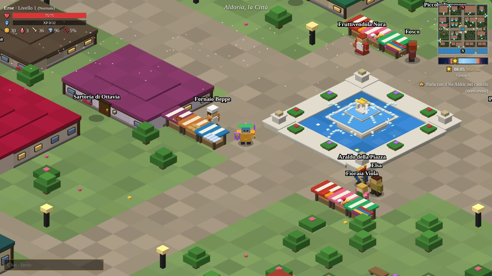
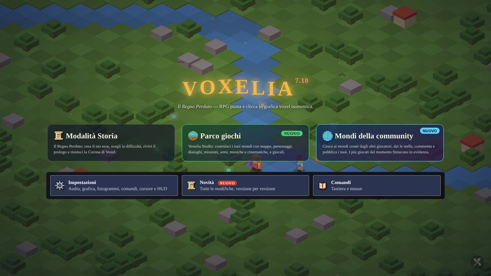
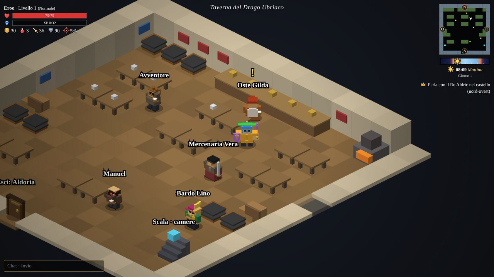
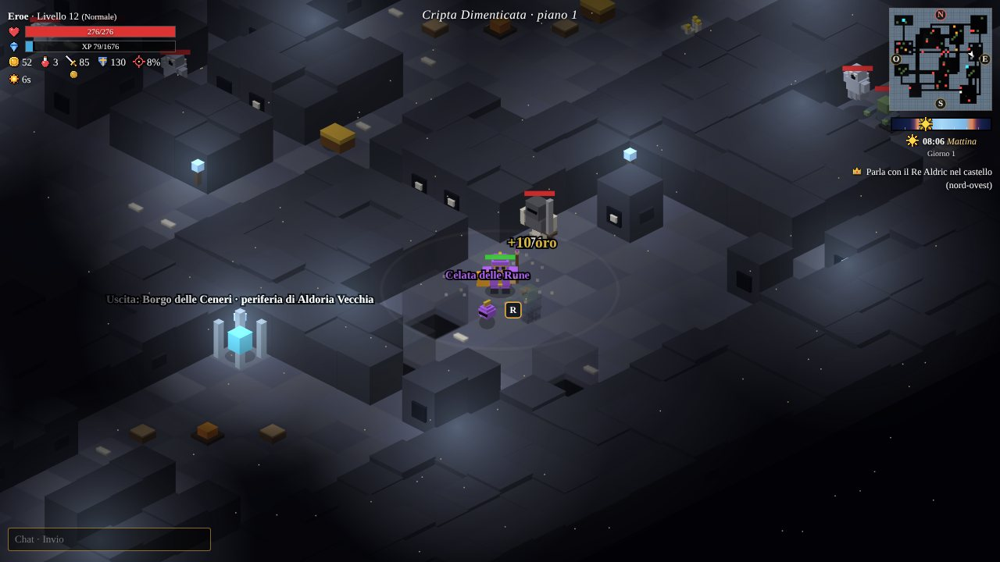
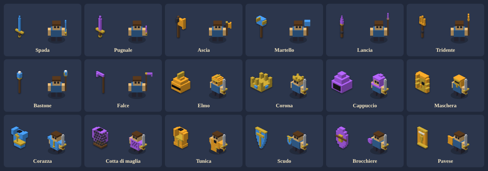
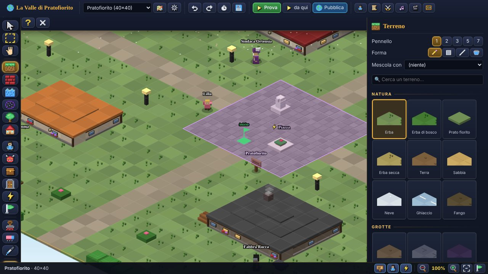

# Voxelia – The Lost Kingdom

**A role-playing game in isometric voxel graphics that runs in the browser and plays with mouse, keyboard or touch.**
Play alone or with friends. Explore the city of Aldoria and the kingdom around it and fight in the dungeons. In
Tomorrow you found a kingdom of your own, and with the **Voxelia Studio** editor you build worlds for others to play.

🇬🇧 English · 🇮🇹 **[Italiano](README.it.md)**

**Current version: 8.7.1** · [📖 Guide](#the-complete-guide) · [🎮 Getting started](#getting-started) ·
[⌨️ Controls](#controls) · [🖥 Server](#the-multiplayer-server) · [🛠 Development](#development) ·
[📝 What's new (CHANGELOG)](CHANGELOG.md)



> *The Lich King Malakar has shattered the Voxel Crown into six shards. Explore Aldoria, take on quests, conquer the
> dungeons that rise again after every victory and challenge other heroes in the Colosseum.*

---

## The complete guide

> 📖 **[The Codex of Aldoria, the complete guide to Voxelia](https://xvxvxvxvvxvxvvxvxv.github.io/Voxelia/)** (in Italian, updated to 7.49.1)
> This README is the summary: it says what the game is, how to start it and how the project is built. The guide explains
> everything, step by step: story and true ending, characters, quests, dungeons, combat, Tomorrow and your kingdom,
> Thalassa, crafting, Voxelia Studio, the server and the plugins, with the map of Aldoria, game images and search.
> It's a static site published with GitHub Pages from the `gh-pages` branch.

What's new in every version, newest first, is in [CHANGELOG.md](CHANGELOG.md) (in Italian in
[CHANGELOG.it.md](CHANGELOG.it.md)), and in the game under the **What's new** menu.

---

## Contents

| To play | The game | The server | The project |
|---|---|---|---|
| [At a glance](#at-a-glance) · [Gallery](#gallery) | [Story Mode](#story-mode) | [The multiplayer server](#the-multiplayer-server) | [Project structure](#project-structure) |
| [Getting started](#getting-started) | [Combat](#combat) | [The admin panel](#the-admin-panel) | [Development](#development) |
| [Controls](#controls) | [The world of Aldoria](#the-world-of-aldoria) | [Server plugins](#server-plugins) | [Previous versions](#previous-versions) |
| [The modes](#the-modes) | [The hero and the equipment](#the-hero-and-the-equipment) | [Putting the server online](#putting-the-server-online) | |
| [Settings and saves](#settings-languages-and-saves) | [Things to do](#things-to-do) | | |
| | [Tomorrow](#tomorrow) | | |
| | [The 3D view and graphics](#the-3d-view-and-graphics) | | |
| | [Music](#music) | | |
| | [Voxelia Studio](#voxelia-studio) and [Community worlds](#community-worlds) | | |

---

## At a glance

- **A single file.** The whole game is `voxelia.html`: graphics, music, text and logic. To play alone you need no
  installation, libraries or internet connection.
- **A big kingdom**: 121 areas (84 interiors to explore), 12 multi-floor dungeons, 196 characters, 130 quests, 93 kinds
  of enemies including 18 bosses. Beyond the sea lies a second kingdom, **Thalassa**; after the true ending, **Act II**.
- **A story told through cutscenes** shot in the game's real locations, with choices that change the ending.
- **Tomorrow**: a borderless world, generated as you walk, where you conquer land, found cities and wage war with the
  factions, together with other players too.
- **Classic view or 3D view**, switch whenever you like, with sunlight, shadows, reflecting water and a horizon.
- **70 tracks written note by note**, plus procedural ones, played in real time by the game's synthesizer.
- **Multiplayer** with a Node.js server **with no dependencies**: rooms, chat, trading, PvP arena, admin panel and plugins.
- **Voxelia Studio**: a full editor to create worlds and **publish** them on the server.
- **On every screen**: computers, phones and tablets (touch controls) and Meta Quest (virtual reality).
- In **English** (the default language) and **Italian**, the language it's written in, plus Eldorian, the kingdom's
  ancient tongue.

---

## Gallery

Images from version 7.51.

<table>
<tr>
<td width="50%"><br><sub><b>The 3D view</b> · Aldoria with hills and fields up to the horizon</sub></td>
<td width="50%"><br><sub><b>The prologue</b> · the founding of Aldoria, in a scene drawn in pixel art</sub></td>
</tr>
<tr>
<td><br><sub><b>Combat</b> · against the goblins in Elmwood Forest</sub></td>
<td><br><sub><b>Thalassa</b> · the kingdom beyond the sea: the Spice Market and the piers</sub></td>
</tr>
<tr>
<td><br><sub><b>Tomorrow</b> · your city at level 15, in the 3D view</sub></td>
<td><br><sub><b>On the phone</b> · joystick, Strike, Lunge, Dodge, Potion and Menu</sub></td>
</tr>
</table>

---

## Getting started

### Alone, in the browser
1. Download or open `voxelia.html` in a recent browser (Chrome, Edge, Firefox, Safari).
2. In the menu, the Voxel Crown, pick the **Story Mode** gem, create your hero and choose the difficulty.

The game saves itself in the browser. It also works offline.

### With friends
You need [Node.js](https://nodejs.org) 16 or newer:

```sh
node server.js
```

The server asks for the admin panel password (or reads it from `ADMIN_PASSWORD`) and prints the addresses to open,
for example `http://192.168.1.20:3000`. Whoever types the **same room code** in the menu (the "Room" field) plays
together; with the field empty you play alone.

To play with friends on different networks use a tunnel (for example `cloudflared tunnel --url http://localhost:3000`)
or put the server online: see [Putting the server online](#putting-the-server-online).

---

## Controls

### Keyboard and mouse

| Key | Action |
|---|---|
| Click on the ground, **W A S D** or arrows | Move |
| Click on enemies, chests, items, characters | Attack (if the enemy is far the hero walks there first), open, pick up, talk |
| **R** | Interact with what's near you |
| **Space** or **X** | Attack: each press does the next move in the chain; held down, the charged strike |
| **Shift** | Roll (press and release) · run (hold while moving) |
| **E** | Roll |
| **F** | Lunge (different for each weapon) |
| **1 2 3 4** | Martial arts skills |
| **Q** | Drink a potion |
| **Tab** | Lock the target · switch to the next enemy |
| **Z** | Tame the nearest weakened monster |
| **H** | Mount or dismount a horse |
| **I** · **J** · **K** | Backpack · Quests · Journal |
| **L** · **P** | Leaderboard · Players |
| **M** | Map (in Tomorrow, the world map) |
| **N** | Companions (the stable) |
| **C** | Hero's look |
| **O** | Options |
| **V** | Action wheel (the key can be changed) · in your village or house, the editor |
| **B** | Classic view or 3D view |
| **F8** | Photo mode |
| **F9** | Developer panel (on servers only with the admin password) |
| **Enter** | Chat |
| **Esc** | Closes the open window; with nothing open, the pause menu |
| Mouse wheel | Zoom (in 3D it brings the camera closer) |
| Right mouse button, dragging | In 3D, turns the camera |

**Tomorrow only:** **U** territory, conquest and settlements · **Y** factions · **T** make camp · **G** teleport gems.

Each key opens and closes its own window, and only one window opens at a time.

### Phones and tablets
On touch devices you get the **joystick** (bottom left, it starts where you touch), the **Strike**, **Lunge**,
**Dodge**, **Potion** and skill buttons, the green **use** button when there's something nearby and the grid **Menu**
with every window. Zoom with two fingers. The controls adapt by themselves to phones, foldables and tablets, and can be
moved and resized with the **HUD editor** (Settings → Interface).

### Meta Quest (virtual reality)
In the Quest browser an **Enter VR** button appears. You play **in first person**, life-size, weapon in hand: you
attack by moving the controller. During cutscenes and minigames you're brought back to a floating screen automatically.
The page must be opened from an **https** address (or from `localhost`): see [Playing on Meta Quest](#playing-on-meta-quest).

<details>
<summary><b>Controller commands</b></summary>

**Floating screen**

| Command | Controller |
|---|---|
| Point and click / scroll a window | Controller ray + trigger / right stick up and down |
| Move | Left stick |
| Zoom | Right stick (forward and back) |
| Interact (R) / Dodge (or close window) | A / B |
| Potion / Backpack | X / Y |
| Area strike / Lunge | Left / right grip |
| Map / Bring the screen back in front | Press the left / right stick |

**First person**

| Command | Controller |
|---|---|
| Attack | Slash with the right controller · right trigger (enemy in front) |
| Lunge / Area strike | Thrust forward · right grip / both hands down together · left grip |
| Walk / Turn | Left stick (you walk where you look, or for real in the room) / right stick |
| Interact / Dodge or close | A, or trigger pointed at a person, door or item / B |
| Potion / Backpack / Map | X / Y / press the left stick |
| VR menu | Left trigger pointed at empty space: first person on/off, rotation, vignette, view distance, speed, eye height |

</details>

---

## The modes



The menu is the **Voxel Crown** in 3D: each gem leads to a mode.

| Gem | Mode | What it is |
|---|---|---|
| Ruby | **Story Mode** | The Lost Kingdom: the main adventure, with four difficulties. |
| Emerald | **Tomorrow** | A borderless world, a thousand years after Aldoria, with its own hero and save. It opens when you've finished the Story. |
| Amethyst | **Playground · Voxelia Studio** | The editor to build and play your own worlds. |
| Topaz | **Community worlds** | Worlds published on the server by other players: play them, rate them, comment on them. |
| Diamond | **Prologue and cutscenes** | The prologue and the story scenes you've already seen. On the server also the [previous versions](#previous-versions). |
| Shattered Sapphire | **The broken gem** | This is where Aldoria 3026 was, removed in 8.4 to focus the game on the Story and Tomorrow. The gem stays on the Crown, broken. |

---

## Story Mode

King Aldric entrusts the hero with the quest to recover the **six shards of the Voxel Crown**, guarded by the dungeon
lords. Then there's the **Void Citadel**, where the Lich King Malakar waits. Aldoria also hides secrets, diary pages, a
walled-up quarter and more than one ending: the true ending is won beneath Old Aldoria, against the **Abomination**, in
a five-phase battle.

- **Cutscenes** shot in the game's real locations, with the characters and the hero wearing their own gear. The
  **prologue** tells the story of the Crown in fourteen scenes. Every cutscene can be skipped with "Skip" and rewatched
  from the menu.
- **Choices**: the dungeon bosses surrender and you decide whether to spare them or finish them off. Your path (mercy,
  sword or balance) changes prices, allies and the epilogue. Every day the Wanderer in the square brings a dilemma.
- **Thalassa**, the kingdom beyond the sea: from level 10 Captain Marina, at the Harbor, takes the hero there. It's a new
  chapter, with the Jade Seals, Quetzal's Temple, the Jade Tablets and the mystery of the Pearl. Thalassa is a white
  city on the bay, with the Queen's Palace, the Serpent Square, the Siren Tavern, the Spice Market, the piers and the
  lighthouse; the Emerald Jungle has the waterfall, the river with rope bridges and the temple among the ruins.
- **Act II · The Lost Constellation** (8.6), after the true ending: the nights grow longer and the stars of the Lantern
  go out in the sky, where Aldric the First imprisoned Morvath, the Last Guardian. From the Observatory dome the Star
  Portal leads to the Twilight Valley: three dungeons relight the three stars (the Well of Dead Stars, the Eclipse
  Forge, the Garden of the Upturned Moon) and open Morvath's Keep.

### Difficulty

| Difficulty | Enemies | Loot | When you fall |
|---|---|---|---|
| **Easy** | HP −30%, damage −40% | richer | you respawn in town |
| **Normal** | balanced | normal | you respawn in town losing 15% of your gold |
| **Hard** | HP +50%, damage +40% | poorer | you respawn in town losing 25% of your gold |
| **Nightmare** | HP ×2.2, damage ×2 | poor | **permadeath**: your save is deleted |

On every difficulty enemies attack **in packs** and **Champions** appear, bigger enemies with a golden halo and
guaranteed loot. Bosses fight in **three phases**, have a **weak point** that stuns them and below a quarter of their
health they enter their **last fury**. Voxelia Studio worlds keep the balance chosen by their author.

**The Kingdom Threat** (8.6): in the Story the kingdom becomes more dangerous as you go on, with the story and with the
game days that pass. It goes from 0 to 10 and is shown under the clock. At every level enemies learn something: the
warriors' guard, the beasts' dodges, charges and heavy blows announced by red circles, spread shots, pack fury;
Champions have powers (Shield, Swift, Vampire, Explosive, Summoner) and bosses new moves (Cross, Ring, Last Breath).
From level 2 nights in the open areas are more dangerous, from 3 raiders invade the quarters of Aldoria.

---

## Combat

You fight by clicking where you want to strike: the hero turns toward the cursor and does their weapon's move. A click
on a distant enemy makes the hero walk up to it and then attack. Classic combat can be turned back on in
Settings → Controls.

- **Chains and charged strikes.** Each press does the next move in the three-hit chain; pressing again just as the move
  ends gives a **perfect strike** (+30%). Holding down charges the heavy strike.
- **Stamina.** Attacks, rolls and running use it up and it recharges by itself (the maximum is 100 plus your level, up
  to 160). At zero you're **out of breath**: no attacks, rolls or running until it's back to 30%.
- **Target** (Tab): the hero always faces the locked enemy and every hit goes to it.
- **Weapons that grow**: with use they earn a name and a special move. The **mastery** of each weapon type rises up to
  ★10 (+4% damage per level).
- **Taming monsters**: a monster below a third of its health can be tamed with a **Taming seal** (Z key; not bosses).
  Companions (N key, up to 12 in the stable) fight by your side, grow, evolve at levels 10 and 20 and can be crossbred to
  hatch new species. From crossbreeding the young can be born with a **variant**: Chromatic, Pearl, Coral, Emerald, Ice,
  Shadow, Neon, Storm, Magma, Specter, Gold, Stellar, Diamond and RGB, from common to legendary (the rarer, the stronger;
  parents can pass it on). Companions are renamed in the stable and **traded** with other players; online everyone's
  companion is visible and its hits reach everyone.

<details>
<summary><b>Every weapon's moves</b></summary>

| Weapon | Chain | Charged strike | Lunge (F) |
|---|---|---|---|
| Dagger, rapier | Cut · Backhand · Double stab (bleeding) | Dance of blades | Quick slash · Rapier thrust |
| Sword | Slash · Rising cut · Knight's blow (knocks back) | Whirlwind | Lunge |
| Axe | Heavy slash · Backhand · Shieldbreaker (+30% damage) | Executioner's leap | Slash |
| Hammer, mace | Strike · Uppercut · Smash (stuns) | Earthquake | Smash |
| Spear | Thrust · High thrust · Sweep | Charge | Thrust |
| Trident | Lunge · Lunge · Three prongs (pulls toward you) | Tidal wave | Thrust |
| Staff, scepter | Arcane bolt · Arcane bolt · Chain lightning | Arcane nova | Staff strike |
| Scythe | Reap · Backhand · Harvest (life steal) | Dance of death | Sweep |

The moves are also written on the weapon's card, in the backpack. The **martial arts** of Master Dino, at the barracks
(keys 1–4), are Dragon Palm (level 3), Tornado Kick (5), Shadow Step (8) and Tiger Breath (10).

</details>

---

## The world of Aldoria



- **Aldoria, the city**: the square with the fountain and the market, the King's castle, the library, the tavern, the
  shops, the temple, the casino, the motel, the barracks, the bank, the Crown Tower and dozens of houses to visit.
- **The quarters**: North Aldoria (the Noble Quarter), East Aldoria (Fields and Trades), the **Harbor**, **Ashenburg**
  with the ruins of Old Aldoria, and the **Colosseum** with the PvP arena.
- **Time**: a game day lasts 24 minutes. By day the citizens are out and about, in the evening they go home and at night
  only the guards remain (and experience is worth 20% more). Every half hour there's a **world event**: a dragon, a
  meteor or a rare merchant.

### Beyond the walls

| Area | Level | Boss | To see |
|---|---|---|---|
| Elmwood Forest | 1 | Forest Troll | firefly glade, stone circle, the Hunter's cabin, the Great Oak |
| Desert of Khem | 4 | Eternal Pharaoh | Amir the Merchant's oasis, the Pyramid with the Sphinx, the buried city, the necropolis |
| Frozen Peaks | 7 | Frost Dragon | Ilva's refuge, the frozen village, the frozen lake, the crystal caves |

### The dungeons
The dungeons change shape on every descent and **rise again after every victory**, stronger and richer. On their floors
there are chests, diary pages, **campfires** and the stairs that open by pulling **two levers together**. Before going
in you can pick **curses** that make the dungeon harder and the loot richer.

| Dungeon | Entrance | Level | Floors | Boss |
|---|---|---|---|---|
| Goblin Den | Elmwood Forest | 2 | 2 | Goblin King Grugnak |
| Forgotten Crypt | Ashenburg | 4 | 3 | Velka the Necromancer |
| Pyramid of Khem | Desert of Khem | 6 | 3 | Ancient Sphinx |
| Crystal Caverns | Frozen Peaks | 8 | 3 | Spider Queen |
| Infernal Forge | Frozen Peaks | 10 | 3 | Ignis, Lord of Flame |
| Sunken Abyss | Harbor (seaweed well) | 12 | 3 | Leviathan |
| Jade Temple | Emerald Jungle (Thalassa) | 14 | 3 | Quetzal, the Jade Serpent |
| Void Citadel | Aldoria Castle | 15 | 4 | Lich King Malakar |



The **Crown Tower** is the daily challenge: randomly built floors, the same for everyone and ever harder, with the
blessings and the leaderboard of the Tower plugin. In Aldoria it stands to the north-east, on the grass near the
Observatory. After each floor you pick a blessing (also from the altar in the middle of the hall), then the stairs open.

### The sea and the battles
- **Naval battle** against Captain Scarlet's *Black Widow*, with cannon fire and boarding.
- **Ryan the Bald's battlefields**: five battles in which you command an army.

---

## The hero and the equipment

- **Look** (C key): skin, hair, eyes, beard, clothes, cloak and build.
- **Four slots**: weapon, helmet, armor and shield. Every item shows on the hero, with the same model as its icon in the
  backpack.
- **Rarity**: Common, Rare, Epic, Legendary and Arena. Bosses also drop **unique items**.
- **Borin's Forge**: complete sets, forging of rare and epic items and upgrades up to **+5**.
- **Backpacks** from 24 up to 48 slots. Items can be locked, dropped, sold or destroyed.
- **Potions** (Q key): each one restores 35% of your health, with 2.5 seconds between sips.




---

## Things to do

| | |
|---|---|
| **Quests** | 130 quests in Aldoria (yellow exclamation mark), plus the Thalassa chapter |
| **Fishing** | 25 species from the pier and from the boat, with the plugin's fishing contest |
| **Crafting** | At the Crafting Workshop you cook, brew potions and forge; recipes are discovered by trying ingredients |
| **Horses** | At the Fields' Stable, with horse racing |
| **Cards** | The elemental card duel at the tavern, with Aldoria's characters |
| **Pets** | A friend from the Pet Shop that follows you and digs for you |
| **Digging** | With the shovel you find buried treasure and secret caves |
| **Casino and motel** | Slots, dice, roulette and blackjack; a room with a bed to sleep (and dream) |
| **Photos** | Photo mode (F8) with poses, filters and frame |
| **Discoveries** | The journal of places, creatures, resources and fish, with rewards |
| **Leaderboards** | Every week fishing, Colosseum, dungeons and cities reward the top three with titles and cloaks |

---

## Tomorrow

A thousand years after Aldoria the Crown is destroyed and the world has reformed into new lands. Tomorrow has its own
hero and save: your Story game isn't touched.


### A world that never ends
- The world is made of **regions** generated as you walk, with five biomes (meadows, woods, deserts, snowy peaks, ash
  wastes), rivers and paths that continue from one region to the next.
- **Villages and cities** with streets, a square, a market, houses you can enter and people who follow their habits.
- **Dungeons** with their own name and a boss with mixed abilities; **monsters that are always different**, stronger
  the farther you go. There's no level cap.
- **World map** (M), **camp** (T) to rest and cook, **teleport gems** (G) and the Travel Stone.
- **Weather and seasons** that change harvests and travel.


### Contracts, unique items and trading
- **The Contract Board** in every village offers new, unique contracts every day (bounties, infestations,
  expeditions, relics, sieges, messages, battles), with named targets, pacts that raise the stakes, stars and
  reputation with six factions.
- **Unique items**: every item is born from a seed that decides shape, rarity, quality, powers, name, story and serial
  number. In trades only the seed travels, so an item can't be inflated by hand.
- **Trading** between heroes of uniques, artifacts, gold and potions, with the **provenance** of every item.
- **The Quest Board** (Board plugin): deliveries and hunts that players set for each other.

### Your kingdom

| | |
|---|---|
| **Conquest** (U) | Plant your banner in a wild region and slay its monsters: at 100% the region is yours |
| **Cities** | Up to 8 cities, each up to level 15, with buildings, treasury, inhabitants, taxes and an army; you respawn at the capital |
| **Village editor** (V) | Move and build buildings, houses, roads, squares, walls, furniture and block cubes; custom buildings |
| **Resources** | Wood, stone, clay and iron from the wilds, from the Sawmill, the Quarry and the **Mine** (where you dig by hand) |
| **Citizens** | They eat, drink, want work and happiness: if these are missing they leave or protest |
| **Army** | The Barracks trains the soldiers who defend your lands and fight with you |
| **Your house** | The storage, interiors to furnish, the message board and the trophy shelf |
| **Caravans** | They carry goods to your cities or to villages; bandits can raid them |
| **Factions** (Y) | Six factions with a crest and lands; join one or found your own. Online the faction builds a shared city |
| **Wars** | Factions raid your lands and declare war on each other, with scheduled sieges (Territories and Factions plugins) |

---

## The 3D view and graphics

Switch from the classic view to the 3D view at any time with the **B** key, the **3D** button or from the pause menu.

- **Camera** behind the hero: turn it with the right button (or two fingers) and zoom with the wheel (or a pinch). Walls
  and trees in front of the hero turn see-through.
- **Light and materials**: the sun follows the time of day, with shadows, stars at night and torches that really light
  things up. Water reflects the sky and the horizon stretches to the mountains. The style is voxel (sharp-edged cubes)
  or smooth.
- **Options** (Settings → 3D View and → Graphics): detail, shadows, grass, horizon, field of view, fog, internal
  resolution with FSR-style upscaling and sharpening. If the game slows down, the resolution drops by itself.
- In cutscenes, fishing, sailing and the editor you go back to the classic view automatically. WebGL 2 is required.

---

## Music

All the music is generated in real time by the game's synthesizer (Web Audio): **70 written tracks** note by note, with
melody, chords, bass, accompaniment and drums, and procedural tracks for the special areas. Every area and every
building in Aldoria has its own track: the tavern dances a jig, the forge beats on the anvil, the temple sings in
chorus. There are 19 instruments. Music is chosen from Settings or the pause menu: automatic, a fixed track, the radio
or off.

---

## Voxelia Studio



The **Playground** is an editor to create adventures with the same blocks, furniture, characters, enemies and music as
the game, try them on the fly (**▶ Test**) and play them from start to finish.

- **Maps** from 16×16 to 96×96, linked by doors, with 14 starting templates.
- **Characters** with node-based dialogue, trades and walks; **quests**, **items and weapons** with special effects.
- **Events** with variables, conditions and 26 actions; **track composer**; **cutscenes**.
- **World check** (🩺): finds doors with no destination, impossible quests and unreachable items.
- Worlds are saved in the browser and **exported** to a `.voxelia.json` file. There's a sample world, "The Valley of
  Pratofiorito".

## Community worlds

With a server, Voxelia Studio worlds are **published** (the **Publish** button in the editor) and appear in the world
browser: featured, trending, top rated and most played, with search, filters, gallery, stars, reviews and comments.
Admins can hide worlds, respond to reports and block authors.

---

## Settings, languages and saves

- **Settings** in 8 categories: General, Audio, Graphics, Performance, Animations, Interface, Controls and Cursor, plus
  the 3D View.
- **Languages**: **English**, the default language (since 8.7; the game is being translated in stages, and the first
  stage covers menus, settings, interface and Story Mode); **Italiano**, the language the game is written in;
  **Eldorian**, the kingdom's ancient tongue. Change it in Settings → General → Language.
- **Saves**: everything stays in the browser (`localStorage`): the game, Tomorrow separately, settings, the hero's look,
  Voxelia Studio worlds and the cutscenes already seen. The save updates by itself, even when you close the page, and
  stays compatible from one version to the next.
- **Exporting and importing the hero**: in the Story and Tomorrow menus (and in the pause menu, to export) the hero is
  downloaded to a `.voxelia-eroe.json` file and loaded back from it, even on another computer. The file holds the whole
  hero except the room code; when importing, the game checks that it's complete and untouched, and if there's already a
  hero it asks for the two confirmations, with the option to export it first. Heroes on Nightmare difficulty can't be
  exported or imported, because their death is permanent.
- **Overwriting a game** asks for two confirmations: a screen in the menu showing the hero you'd lose, then a notice at
  the bottom to confirm within 12 seconds. Without the second confirmation nothing is deleted.

---

## Previous versions

The [`releases/`](releases/) folder holds the published builds, from 4.5 to today, listed in
[`releases/LEGGIMI.md`](releases/LEGGIMI.md).

On the server they can also be played from the menu: the **Previous versions** button or the Diamond gem. Every old
version opens from `/versioni/<version>/` with two guarantees:
- **solo only**: no chat, arena, trading, community worlds or plugins (the browser blocks every connection for it);
- **separate saves**: each version writes to its own part of the save and doesn't touch the current game.

---

## The multiplayer server

`server.js` is a single file for Node.js 16+ **with no npm dependencies**. It serves the game and the admin panel, and
keeps the **rooms** (whoever types the same code plays together), the **chat** with clickable links, **trading**, the
**PvP arena** with its shop, the **leaderboard**, the shared **dungeon cycles** and **world clock**, **shared enemies**
(everyone sees the same ones), the **Community worlds** and the **plugins**.

The game, the previous versions and the admin panel are prepared once and kept in memory **already compressed**
(brotli or gzip, depending on the browser): the game arrives in about 0.8 MB instead of 3, and returning players only
get the confirmation that it hasn't changed (ETag). `/salute` answers immediately, for health checks.

### Environment variables

| Variable | Default | What it's for |
|---|---|---|
| `PORT` | `3000` | HTTP and WebSocket port |
| `ADMIN_PASSWORD` | (asked at startup) | Admin panel password. Without a terminal one is generated and printed in the log. |
| `TLS_CERT` / `TLS_KEY` | (none) | PEM certificate and key: the server speaks **https** and WebSockets switch to **wss** |
| `DATA_FILE` | `voxelia-data.json` | Leaderboard, arena points, dungeon cycles, settings, bans, plugin data |
| `MONDI_DIR` | `mondi/` | Folder of published worlds |
| `PLUGINS_DIR` | `plugins/` | Plugins folder |

### The admin panel
It opens at `http://address:port/admin`.

| Page | What it does |
|---|---|
| **Overview** | Server status |
| **Players** | Player list, with heal, teleport and kick |
| **Rooms** | Open rooms and dungeons |
| **Chat** | Chat and announcements |
| **Leaderboard** | The leaderboard |
| **Bans and mutes** | Bans and mutes |
| **Settings** | Max players, closed rooms, PvP, trading and chat, message of the day, multipliers, community worlds |
| **Log** | The event log |
| **Plugins** | Plugins on and off, errors, commands and pages |
| **Worlds** | Moderation of published worlds |
| **Server** | Memory, load and data backups |

**The developer panel on servers** is for admins only: the 🛠 button is hidden, and F9 (or `#dev` at the end of the
address) asks for the admin password, which the server checks. Every action ends up in the admin panel's log. Opening
`voxelia.html` from disk the panel stays as always.

### Playing on Meta Quest
The Quest only offers virtual reality on **https** pages or on `localhost`.

<details>
<summary><b>Three ways to get https</b></summary>

1. **Online server or tunnel** (the simplest). The published server already has https. At home a tunnel is enough, then
   open on the Quest the `https://` address it prints:
   ```sh
   cloudflared tunnel --url http://localhost:3000
   # or: ngrok http 3000
   ```
2. **HTTPS from the server, on the local network.** Create a certificate for the PC's address and start the server with
   `TLS_CERT` and `TLS_KEY`:
   ```sh
   # with mkcert
   mkcert 192.168.1.20 localhost
   TLS_CERT=192.168.1.20+1.pem TLS_KEY=192.168.1.20+1-key.pem node server.js
   # or self-signed with openssl
   openssl req -x509 -newkey rsa:2048 -nodes -days 365 -keyout key.pem -out cert.pem \
     -subj /CN=192.168.1.20 -addext "subjectAltName=IP:192.168.1.20,DNS:localhost"
   TLS_CERT=cert.pem TLS_KEY=key.pem node server.js
   ```
   On the Quest open `https://192.168.1.20:3000` and accept the certificate (**Advanced → Proceed**).
3. **USB cable with `adb reverse`** (with the Quest's developer mode on):
   ```sh
   adb reverse tcp:3000 tcp:3000
   ```
   Then on the Quest open `http://localhost:3000`.

</details>

---

## Server plugins

Plugins are `.js` files in the `plugins/` folder. They load at startup or with **Plugins → Reload** in the admin panel,
and can be turned on and off without restarting. How to write one is explained (in Italian) in
[plugins/LEGGIMI.md](plugins/LEGGIMI.md); their versions are in [plugins/CHANGELOG.md](plugins/CHANGELOG.md).

> ⚠️ A plugin is code that runs on the server with full permissions: only install plugins you trust.

<details>
<summary><b>The 29 included plugins</b></summary>

| Plugin | What it does |
|---|---|
| **Hall of Heroes** (`albo.js`) | Web page with every hero's card and the `/albo` command |
| **Quest Board** (`bacheca.js`) | Tomorrow players' quests: deliveries and hunts with a gold reward (`/bacheca`) |
| **World boss** (`boss.js`) | A huge boss to face all together, with rewards based on contribution (`/boss`) |
| **Houses** (`housing.js`) | A house for every hero to furnish, with storage, pets and the Houses Village (`/casa`) |
| **Treasure hunt** (`tesoro.js`) | A treasure hidden in the city with clues in stages (`/tesoro`) |
| **Leaderboards** (`classifiche.js`) | The weekly leaderboards with titles and cloaks (`/classifiche`) |
| **Disco** (`discoteca.js`) | A disco with a DJ, tracks from YouTube and SoundCloud, queue, votes and lights (`/discoteca`) |
| **Emotes and bubbles** (`emote.js`) | Emotes with a speech bubble above the head (`/saluta`, `/ridi`, `/balla`…) and the emote wheel |
| **Example** (`esempio.js`) | A sample plugin to start from |
| **Factions** (`fazioni.js`) | Tomorrow players' factions: roles, permissions, shared city, wars and sieges (`/fazione`) |
| **Photos** (`foto.js`) | The server Gallery for photo-mode pictures (`/foto`) |
| **Fishing contest** (`pesca.js`) | Record book, timed contests and legendary fish announcements |
| **Adventure parties** (`gruppi.js`) | Parties of up to 4 heroes with chat, shared experience and gold (`/gruppo`) |
| **Guardian** (`guardiano.js`) | Detects gold, levels and items obtained by cheating, with an admin page of the evidence |
| **Cops and robbers** (`guardieladri.js`) | Team hide-and-seek in a quarter (`/guardie`) |
| **Message board** (`lavagna.js`) | The message board in houses, with housemates (`/lavagna`) |
| **Aldoria Flea Market** (`mercato.js`) | Buying and selling items between players, even offline (`/mercato`) |
| **Hunting nights** (`notti.js`) | Night events with multiplied experience and a points race (`/evento`) |
| **Mail and friends** (`posta.js`) | Messages for offline players (`/posta`) and friend notifications (`/amici`) |
| **Daily reward** (`giornaliero.js`) | A reward a day, richer day after day (`/giornaliero`) |
| **Back to Aldoria** (`hub.js`) | `/hub` takes you back to Aldoria from any area |
| **The Mayor of Aldoria** (`sindaco.js`) | Weekly mayoral election and decrees (`/vota`, `/sindaco`) |
| **Dungeon speedrun** (`speedrun.js`) | Timer, leaderboards, records and the weekly challenge (`/speedrun`) |
| **Stress test** (`stress.js`) | Fake bots that play on the server to measure latency, memory and errors |
| **Daily bounties** (`taglie.js`) | New bounties every day (`/taglie`) |
| **Teleport** (`tpa.js`) | `/tpa <name>` to reach another hero, if they accept |
| **Territories** (`territori.js`) | Tomorrow's shared lands: sieges, raids and chronicle (`/terre`) |
| **Arena tournament** (`torneo.js`) | Knockout tournaments in the Colosseum, with a bracket and prizes |
| **Tower** (`torre.js`) | The daily leaderboard of the Crown Tower: floors cleared and time (`/torre`) |

</details>

---

## Putting the server online

### Docker
The `Dockerfile` builds an image with the server, the game, the previous versions, the admin panel and the plugins
(from `node:20-alpine`, with a non-root user and a health check). Persistent data lives in `/data`.

```sh
docker build -t voxelia .
docker run -d -p 3000:3000 -e ADMIN_PASSWORD='your-password' -v voxelia-data:/data --name voxelia voxelia
```

### Docker Compose
`docker-compose.yml` starts the image published on GitHub Container Registry (`ghcr.io/xvxvxvxvvxvxvvxvxv/voxelia`):

```sh
ADMIN_PASSWORD='your-password' docker compose up -d
```

The image is published by the `.github/workflows/docker.yml` workflow on every push to `main`, tagged with the game
version and `latest`. For https from the container, put `cert.pem` and `key.pem` in `certs/` and uncomment the
`TLS_CERT`, `TLS_KEY` and `./certs` lines in `docker-compose.yml`.

### Suga
The official server runs on [Suga](https://suga.app). The container is built **from this repository** on every push to
`main`, with an HTTPS endpoint on port 3000, a volume on `/data` and `ADMIN_PASSWORD` as a secret variable. After the
push the new version is online in a couple of minutes, and the log shows
`Voxelia <version> in ascolto sulla porta 3000`.

---

## Project structure

```
voxelia.html            the complete game, generated by build.sh (don't edit it by hand)
server.js               multiplayer server, admin panel, plugins, worlds and previous versions
admin.html              admin panel interface
build.sh                joins the sources into voxelia.html and checks the syntax
tools/verifica.sh       the check before publishing (build, syntax, versions, test server)
tools/prova.js          the automatic test: the modes, the saves and two players online (needs Playwright)
tools/bilancia.js       balancing: a robot plays the dungeons and reports how much health each enemy costs
CHANGELOG.md            every change in English, newest first (it also ends up inside the game)
CHANGELOG.it.md         every change in Italian, from the very first version (also inside the game)
README.it.md            the Italian version of this file
src/                    the game's sources
plugins/                server plugins (with LEGGIMI.md and CHANGELOG.md)
releases/               the builds of the published versions, listed in LEGGIMI.md
docs/                   images for this README
Dockerfile              server image
docker-compose.yml      start with Docker Compose
.github/workflows/      the check on every push and PR, and publishing the image to GitHub Container Registry
```

The sources live in folders, one per part of the game:

| Folder | What's inside |
|---|---|
| `src/base/` | The basics: engine, data, world, drawing, hero, interface, network, startup |
| `src/storia/` | Story Mode: Aldoria, the cutscenes, Thalassa, the choices and the ending |
| `src/combattimento/` | Combat, bosses, dungeons, companions, elements and chimeras |
| `src/tomorrow/` | Tomorrow: the endless world, villages, factions and wars |
| `src/corona/` | The Crown menu, the shards, the Heart of the Crown and the Album |
| `src/studio/` | Voxelia Studio (the editor) and the Community worlds |
| `src/grafica/` | The 3D view, virtual reality and graphics options |
| `src/sistemi/` | Parts shared by the whole game: events, crafting, pets, photos, menu, fixes |
| `src/lingua/` | Languages: the engine that translates the game as it shows it, and the English translations |

Only `head.html` (the page) and `9_changelog.js` (generated by `build.sh`) stay directly in `src/`.

`build.sh` lines up `src/head.html` and all the `[number]_*.js` files of the folders in alphabetical order of the
**file name**, whatever the folder (`LC_ALL=C`, so `75_tempo.js` comes before `7_net.js`). Two files with the same name
in different folders stop the build. All the code shares a single global scope: later files can extend or replace the
functions of earlier ones. That's why new files are added at the end, with a name that sorts after the others
(`8zzzzk_…`, `8zzzzl_…`), in the folder of the part of the game they touch.

The game is written in Italian. **English is a translation applied as the game shows text**: `src/lingua/9a_lingua.js`
looks up every piece of text on screen (page text, tooltips, field placeholders, text drawn on the map, browser
dialogs) in the dictionaries of the `9b_en_*.js` files. Each entry is the Italian text exactly as it is in the code, with
`{0}`, `{1}`… in place of the parts that change, and its English: the changing parts are translated too, when they have
a translation of their own. The game's logic never sees the translation.

<details>
<summary><b>What's in each file of <code>src/</code></b></summary>

**The basics**

| File | Contents |
|---|---|
| `head.html` | Page, styles, menu and interface structure |
| `base/1_core.js` | Utilities, isometric projection, voxel box drawing, audio engine, version (`GAME_VER`) |
| `base/2_data.js` | Voxel models, items and rarities, enemies, areas, dungeons, characters, quests, interiors |
| `base/3_world.js` | World generation: city, open areas, dungeons, interiors, doors |
| `base/4_render.js` | Drawing the world and furniture, scenes, fishing, naval battle, map, dreams, Dimension, translations, icons |
| `base/4a_aldoria.js` | A bigger Aldoria: new buildings and interior furniture |
| `base/4b_fast.js` | Faster graphics: still walls and furniture drawn once into sprite sheets |
| `base/5_game.js` | Hero, combat, loot, quests, interactions, world update, saving |
| `base/6_ui.js` | HUD, windows (backpack, quests, shops, dialogue, casino…), settings, what's new |
| `base/75_tempo.js` | Day and night |
| `base/76_icone.js` | Pixel-art HUD icons |
| `base/77_scene.js` | Scenic animations: camera shots, iris, banners, flying items |
| `base/78_aspetto.js` | Hero's look, worn equipment models, portraits |
| `base/79_hudedit.js` | HUD editor |
| `base/7_net.js` | Multiplayer (WebSocket to `server.js`), chat with links |
| `base/8_main.js` | Animated menu, written music, story, square and city routines, castle, Malakar, animations, places, dialogue, characters' looks |
| `base/8_main0_attivita.js` | Fishing, Stefano and the Filly, Ryan the Bald's battles, Manuel |
| `studio/8_main1_studio.js` | Voxelia Studio: the editor, the playable worlds, windows, music, cutscenes, icons, tools |
| `base/8_main2_avvio.js` | Startup, saves and menu, keyboard, main loop, cursor |
| `9_changelog.js` | Generated by `build.sh` from `CHANGELOG.md` and `CHANGELOG.it.md`: don't edit it by hand |

**Story, Aldoria and cutscenes**

| File | Contents |
|---|---|
| `storia/8t_touch.js` | Touch controls for phones and tablets |
| `storia/8u_musiche.js` | The buildings' songs, the new instruments and drum kits |
| `storia/8v_abominio.js` | The true ending: the five-phase Abomination, Queen Elara's shadow, Malakar's shield |
| `storia/8v_sfida.js` | Story Mode difficulty: stronger enemies, packs, Champions, the bosses' last fury |
| `storia/8w_icone.js` | Voxel icons throughout the game |
| `storia/8x_dev.js` | Developer panel (on servers, with the admin password checked by the server) |
| `storia/8y_film.js` | The cutscene engine: real locations, walking actors, camera, subtitles |
| `storia/8y_film2.js` | The cutscenes of the story, the naval battle and Voxelia Dimension |
| `storia/8y_film3.js` | The prologue scene beneath the city: the layers of earth, the well, the Eye |
| `studio/8z_mondi.js` | Community worlds: browser, cards and publishing |
| `storia/8za_mondo.js` | New furniture, the real Colosseum (outside and inside) |
| `storia/8zb_mappa.js` | The map of the area you're in (M key) |
| `storia/8zc_prova.js` | Developer panel: testing every boss fight |
| `storia/8zd_biomi.js` | Forest, desert and peaks: the layout, the places, the gathering |
| `storia/8zd_biomi2.js` | How the biomes, the interiors and their characters are drawn |
| `storia/8ze_ricordo.js` | Moreau's memory: Old Aldoria before the fog |
| `storia/8zj_citta.js` | "The streets of Aldoria", the city theme, and the music engine's dynamic sections |
| `storia/8zr_caricamento.js` | The loading screens and the gem-travel cutscene |
| `storia/8zs_modelli.js` | Skeleton models and animations for bosses and animals |
| `storia/8zza_prologo.js` | The Story's prologue: the scenes and its three tracks |

**Virtual reality and 3D view**

| File | Contents |
|---|---|
| `grafica/8zf_xr.js` | Virtual reality (WebXR) for Meta Quest: floating screen, controllers, sticks |
| `grafica/8zg_xrui.js` | The game's HTML interface shown in the headset |
| `grafica/8zh_xr3d.js` | The 3D world on the table (diorama) |
| `grafica/8zi_xrfp.js` | First person: life-size world, controller attacks, floating panels |
| `grafica/8zm_3d.js` | The WebGL 2 3D view: light, shadows, materials, sky, horizon, voxel or smooth style, camera |
| `grafica/8zn_pausa.js` | The pause menu and the "3D View" settings section |
| `grafica/8zzl_grafica.js` | Water on a separate sheet, dynamic resolution, graphics options and FSR-style upscaling |

**Combat and companions**

| File | Contents |
|---|---|
| `combattimento/8zu_combattimento.js` | Hit chains, perfect strike, charged strikes, every weapon's moves, hero poses |
| `combattimento/8zv_domare.js` | Taming monsters: seals, companions, levels and evolutions, the stable, the bestiary |
| `combattimento/8zzg_azione.js` | Action combat: click toward the cursor, stamina, roll, run, target lock |
| `combattimento/8zzu_boss.js` | Three-phase bosses, with the weak point and stun |
| `combattimento/8zzv_leve.js` | The two levers on dungeon floors, to be pulled together (online too) |
| `combattimento/8zzw_maledizioni.js` | The curses to choose before dungeons |
| `combattimento/8zzx_armi.js` | Weapons that grow (name, special move) |
| `combattimento/8zzy_torre.js` | The Crown Tower, the daily challenge |
| `combattimento/8zzz_scavo.js` | The shovel, buried treasure and secret caves |

**Tomorrow**

| File | Contents |
|---|---|
| `tomorrow/8zk_unici.js` | Unique items: seed generator, powers, card, provenance; trading |
| `tomorrow/8zl_aperto.js` | The base: menu, separate save, Contract Board, targets, sieges, reputation |
| `tomorrow/8zo_tomorrow.js` | The world: endless regions, biomes, villages, dungeons, species, contracts, map, 3D horizon |
| `tomorrow/8zp_vivo.js` | Cities, houses with interiors, inhabitants, animals, shrines, the camp, gems, battles |
| `tomorrow/8zq_mappa.js` | The interactive world map and the contract windows |
| `tomorrow/8zt_mondo.js` | Remembered regions, the camp that stays, the block floor, villages |
| `tomorrow/8zw_regno.js` | Conquest, settlement, factions with seats, emissaries and crests |
| `tomorrow/8zx_guerre.js` | Faction raids, sieges and raids between players (Territories plugin), the chronicle |
| `tomorrow/8zy_tw_film.js` | The universe-reset cutscene, its music and the relics of Aldoria |
| `tomorrow/8zz_borghi.js` | Villages and cities with streets, plots, square, market and people with their habits |
| `tomorrow/8zzb_editborgo.js` | The settlement editor |
| `tomorrow/8zzc_gestione.js` | Resources, costs, Cistern, Farm, Sawmill, Quarry, statistics, food, water and inhabitants |
| `tomorrow/8zzd_editor2.js` | The full editor: every floor, wall and piece of furniture, custom buildings |
| `tomorrow/8zze_esercito.js` | The Barracks, soldiers, army strength, battles |
| `tomorrow/8zzf_miniere.js` | The mines: digging by hand, minerals, historical artifacts |
| `tomorrow/8zzh_casa.js` | Your house with storage, custom interiors and the village walls |
| `tomorrow/8zzi_citta.js` | More cities (up to 8), the capital, materials at the day's prices |
| `tomorrow/8zzj_legna.js` | Trees to fell, wood, the city up to level 15 |
| `tomorrow/8zzk_viaggio.js` | The Travel Stone with every place that has a teleport gem |
| `tomorrow/8zzn_fazione.js` | Player factions (Factions plugin) |
| `tomorrow/8zzq_ordine.js` | The city that grows in order and the walls on the perimeter |
| `tomorrow/8zzza_cittadini.js` | Citizens' needs (work, happiness, taxes, protests) |
| `tomorrow/8zzzb_meteo.js` | Weather and seasons, with effects on villages and on screen |
| `tomorrow/8zzzc_carovane.js` | Caravans and bandit raids |
| `tomorrow/8zzzd_blocchi.js` | Building with blocks in the village editor |
| `tomorrow/8zzze_assedi.js` | Scheduled wars between factions and sieges (Factions plugin) |
| `tomorrow/8zzzr_bacheca.js` | The players' quest board (Board plugin) |

**Life, world and systems**

| File | Contents |
|---|---|
| `sistemi/8zzm_novita.js` | The post-boss portal that asks before leaving, music of your choice, tile-by-tile maps, the Breeding farm |
| `sistemi/8zzo_dev2.js` | The developer panel that gives and creates everything, with the Tomorrow tools |
| `sistemi/8zzp_sync.js` | Online every enemy has an owner that drives it and everyone sees the same copy |
| `corona/8zzr_corona.js` | The 3D Voxel Crown menu |
| `sistemi/8zzs_disegnate.js` | The pixel-art drawn scenes, with letter-by-letter text |
| `sistemi/8zzt_aiuti.js` | Common helpers for new features (fields to save, panels, challenge day) |
| `sistemi/8zzt_versioni.js` | The previous-versions picker (needs the server) |
| `sistemi/8zzta_frasi.js` | The yellow title splash lines |
| `sistemi/8zzzf_cavalli.js` | Horses (H), the stable and horse racing |
| `sistemi/8zzzh_eventi.js` | World events every half hour |
| `sistemi/8zzzi_scoperte.js` | The discoveries journal |
| `sistemi/8zzzk_mestieri.js` | Crafting and the Workshop (Stove, Still, Anvil), recipes, the Recipe book |
| `sistemi/8zzzl_casa.js` | The house message board and the trophy shelf |
| `sistemi/8zzzm_foto.js` | Photo mode (F8) |
| `combattimento/8zzzn_animali.js` | Pets |
| `sistemi/8zzzo_carte.js` | The elemental card duel |
| `sistemi/8zzzp_incroci.js` | Companion crossbreeding |
| `storia/8zzzq_scelte.js` | Choices, the path, allies, the epilogue, titles |
| `storia/8zzzs_oltremare.js` | Thalassa, the Emerald Jungle and the Jade Temple |
| `sistemi/8zzzt_classifiche.js` | The weekly leaderboards |
| `storia/8zzzu_thalassa2.js` | A richer Thalassa: places, characters, Jade Tablets, the mystery of the Pearl |
| `storia/8zzzv_insegne.js` | The neon signs of the Motel and the Casino |
| `sistemi/8zzzv_sovrascrivi.js` | The two confirmations before overwriting a game: the menu screen and the final notice |
| `sistemi/8zzzw_correzioni.js` | No things stacked on top of each other, panel text that wraps, various fixes |
| `storia/8zzzx_thalassa3.js` | Thalassa and the Emerald Jungle rebuilt from scratch, with the new interiors and furniture |
| `sistemi/8zzzy_eroe.js` | Exporting and importing the hero to a file, with the checksum and the confirmations |
| `combattimento/8zzzz_compagni.js` | Companions online (seen by others, shared hits), in trades, crossbreeding variants, renaming in the stable |
| `sistemi/8zzzza_fermo.js` | When a window opens the hero stops; a click outside a window just closes it |
| `combattimento/8zzzzb_elementi.js` | The nine elements of monsters, weapons and companions (fire, ice, lightning, water, poison, earth, wind, shadow, light) and their weaknesses |
| `combattimento/8zzzzc_chimere.js` | Chimeras: weapons, armor and companions assembled from pieces of existing ones |
| `combattimento/8zzzzd_serraglio.js` | The Menagerie of Aldoria, the companions' home, with Selene the Tamer and her stations |
| `combattimento/8zzzze_dungeon.js` | Every dungeon another dimension: rooms of different shapes, their own style and furniture |
| `corona/8zzzzf_zaffiro.js` | The Shattered Sapphire: Voxelia Dimension (7.55) and Aldoria 3026 (8.4) removed from the game; unlocking Tomorrow |
| `sistemi/8zzzzn_dev3.js` | The developer panel to test everything (8.5): story quests and variables, cheats, world, on-screen debug, console, states and testing every area |
| `combattimento/8zzzzq_minaccia.js` | The Kingdom Threat (8.6): the level from story and days, the enemies' new moves, Champion powers, the bosses' extra moves |
| `combattimento/8zzzzr_notti.js` | Dangerous nights and invasions of Aldoria's quarters (8.6) |
| `storia/8zzzzs_atto2.js` | Act II · The Lost Constellation (8.6): the Twilight Valley, four dungeons, creatures, bosses and cutscenes |
| `sistemi/8zzzzt_dev86.js` | The developer panel's "☠ Threat and Act II" tab (8.6) |
| `combattimento/8zzzzk_bilancio.js` | Balancing: Champions per floor, Crypt, Forge, Jade Temple, Tomorrow at high levels (8.1); enemies, Champions and prices that follow your level (8.3) |
| `corona/8zzzzh_corona80.js` | The Reunited Crown: the six shards, the Heart of the Crown and the Album |
| `sistemi/8zzzzh_menu.js` | The menu fits the window: the Crown fills the screen, the other screens shrink instead of scrolling |
| `sistemi/8zzzzi_avvisi.js` | The game's on-screen labels (events, active food, wars…) don't cover the hero box, windows or the end of battle |
| `sistemi/8zzzzj_intralcio.js` | Pets walk behind the hero; R, the green button and clicks pick doors, items and characters first |

**Languages**

| File | Contents |
|---|---|
| `lingua/9a_lingua.js` | The language engine (8.7): English is the default; it translates page text, tooltips, text drawn on the map and browser dialogs, with the changing parts (`{0}`, `{1}`…) |
| `lingua/9b_en_base.js` | English translations of menus, settings, interface and Story Mode (from the Italian text to English) |

</details>

---

## Development

### Building and testing
```sh
sh build.sh             # regenerates src/9_changelog.js and voxelia.html, and checks the syntax
node server.js          # to try it with the server (or open voxelia.html in the browser)
sh tools/verifica.sh    # the full check: build, syntax, versions and a test server
node tools/prova.js     # the modes, the saves after a restart and two players online
node tools/bilancia.js  # a robot plays the dungeons and reports how much health each enemy costs ("storia" for Story only)
```

The same check runs on GitHub on every push and every pull request (the **Verifica** workflow): a PR that breaks the
build, the syntax or the version numbers shows up before the merge.

### Publishing a new version
1. Update the version number in three places: `GAME_VER` in `src/base/1_core.js`; `<title>` and `<sup id="ver">` in
   `src/head.html`; `VER` and the opening comment in `server.js`.
2. Write the entry at the top of `CHANGELOG.md` in English and at the top of `CHANGELOG.it.md` in Italian.
3. Run `sh build.sh`, copy the build to `releases/voxelia_v<version>.html` and add the row to `releases/LEGGIMI.md`.
4. Run `sh tools/verifica.sh`: it must end with "Tutto a posto".
5. Commit and push to `main`: Suga rebuilds and publishes by itself.

### Conventions
- No external dependencies: no frameworks or libraries, just JavaScript, Canvas 2D, WebGL and Web Audio.
- The game is written in Italian; new text must be translated to English in `src/lingua/` (the key is the Italian text
  exactly as it is in the game, with `{0}`, `{1}`… in place of the parts that change). Code comments are in Italian;
  README, LEGGIMI and CHANGELOG are in English, with Italian copies (`README.it.md`, `CHANGELOG.it.md`).
- Saves must stay compatible from one version to the next.
- Versions follow the scheme `7.9` → `7.9.1` → … → `7.10`: the second number for updates with new features, the third
  for fixes.

---

Voxelia is developed by **TeamVoxelia**.
