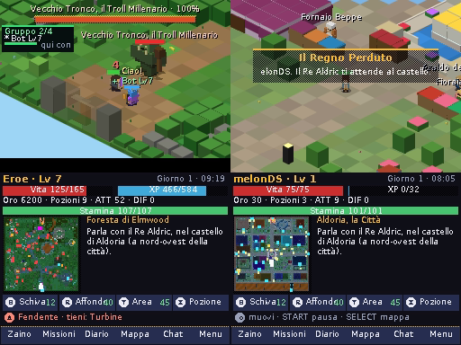

# Voxelia DS 1.3 — Il Regno Perduto

Versione del port: **1.3** (contenuti di Voxelia **8.5**).

Port per **Nintendo DS / DS Lite / DSi** di *Voxelia 8.5 – Il Regno Perduto*. Usa la stessa base del port
per 3DS (cartella [`3ds/`](../3ds)):
- **in comune con il 3DS:** logica del gioco, mondo, missioni e storia, interfaccia, rete e plugin del server;
- **riscritti per il DS:** grafica, testo, audio e comandi.

| | |
|---|---|
| **Scarica** | [`releases/voxelia_nds_v1.3.zip`](releases/voxelia_nds_v1.3.zip): `voxelia.nds`, README, CHANGELOG e PLUGIN |
| **Novità** | [CHANGELOG.md](CHANGELOG.md) · **Plugin del server:** [PLUGIN.md](PLUGIN.md) |
| **In questa cartella** | il port DS: il codice (`source/`), i dati per la ROM (`nitro/`, ricavati da quelli del 3DS), mbedtls per l'ARM9 (`libs/`), gli strumenti (`tools/`) e gli zip di ogni versione (`releases/`) |
| **Gli altri port** | nelle cartelle accanto di questo branch: 3DS in [`3ds/`](../3ds), PS Vita in [`psvita/`](../psvita), PS4 in [`ps4/`](../ps4), PSP in [`psp/`](../psp); il gioco per browser e il server sul branch `main` |



## Installazione

- **Console:** copia `voxelia.nds` sulla scheda di una flashcart, oppure sulla scheda SD di un DSi con
  TWiLight Menu++, e avvialo. I file del gioco sono dentro la ROM (NitroFS), quindi il caricatore deve supportarla.
  Le flashcart recenti e TWiLight Menu++ la supportano.
- **Emulatore:** melonDS (il Wi-Fi funziona anche lì) o un altro emulatore che legga NitroFS.

Il gioco si salva in `/data/voxelia/` sulla scheda (flashcart con DLDI, o SD del DSi): `save.dat` e
`settings.dat`. Senza scheda si gioca lo stesso, ma senza salvare.

## Comandi

| Tasto | Azione |
|---|---|
| D-pad | Muovi l'eroe |
| **A** | Premi: la mossa successiva della catena dell'arma. Tieni premuto e lascia: colpo caricato. Senza nemici vicini, interagisci |
| **L** | Interagisci: parla, apri forzieri, raccogli, entra nelle porte |
| **B** | Capriola (premi e lascia) o corsa (tieni premuto mentre ti muovi) |
| **R** | Toccato: affondo. Tenuto: blocca il bersaglio |
| **Y** | Colpo ad area |
| **X** | Pozione |
| START / SELECT | Pausa / mappa grande |
| Schermo touch | HUD, minimappa, abilità; pulsanti Zaino, Missioni, Diario, Mappa, **Chat** (registro della chat, da cui si scrive), Menu |

Nei menu: D-pad e A, oppure tocca le righe (il primo tocco seleziona, il secondo conferma). Per scrivere c'è
una tastiera sullo schermo touch: START invia, B cancella.

## Multigiocatore

Menu → **Multigiocatore**:
1. scegli il codice stanza;
2. scegli il server (quello ufficiale è già impostato);
3. premi **Collegati**.

Il protocollo è lo stesso del browser e del 3DS, con `wss://` (TLS con mbedtls). Chi gioca dal DS, dal 3DS e dal
browser con lo stesso codice sta nello stesso mondo. Funzionano:
- gli altri eroi, la chat (anche il registro), l'ora del mondo condivisa;
- l'arena PvP, i cicli dei dungeon, i comandi dell'admin;
- i **plugin del server**, come sul 3DS: boss del mondo, caccia al tesoro, taglie, teletrasporto (richieste
  sul touch), /hub, gruppi, emote, tornei;
- il protocollo generico di [PLUGIN.md](PLUGIN.md).

Il collegamento sicuro richiede circa 2 secondi di calcolo sul DS. Avviene in un thread a parte, quindi il gioco
non si blocca.

### Wi-Fi: solo reti aperte o WEP sul DS

Il chip Wi-Fi di **DS e DS Lite** si collega solo a reti **aperte o WEP**. Il WPA/WPA2 c'è solo sull'hardware
del **DSi**, quando il gioco gira in modalità DSi. Il gioco prova, in ordine:
1. la rete scelta in **Multigiocatore → Rete Wi-Fi** (cerca le reti, scegli, scrivi la password; poi se la ricorda);
2. le reti salvate nelle impostazioni Wi-Fi della console.

Se a casa hai solo una rete WPA2, per un DS o DS Lite ti serve una rete aperta o WEP. Per esempio:
- la rete ospiti del router impostata in WEP;
- un vecchio router o un ripetitore in WEP;
- un hotspot aperto creato da un computer.

Il gioco cifra comunque i dati verso il server con TLS, anche su una rete aperta.

## Cosa è stato tagliato rispetto al 3DS

Il DS ha 4 MB di RAM, un processore a 67 MHz senza virgola mobile e disegna al massimo 1.536 quadrilateri per
fotogramma. Il 3DS disegna decine di migliaia di voxel. Quindi:
- **Mondo a blocchi.** Ogni casella è un pavimento più al massimo un blocco (tetto e lati colorati), ricavato dai
  voxel della 8.5 da `tools/dsassets.py`. Gli edifici si riconoscono, i dettagli piccoli no.
- **Personaggi come sprite.** Nemici, personaggi ed eroe sono sprite a 16 colori ricavati dai modelli animati,
  in 5 direzioni (le altre 3 sono specchiate).
  - L'eroe mostra il tipo di arma, la corazza, l'elmo e lo scudo, con i colori della rarità.
  - Il tipo di elmo e di scudo non si vede.
- **Effetti semplificati:** niente 3D stereoscopico, acqua e fiamme ferme, meno particelle.
- **Niente zoom:** la telecamera è fissa.
- **Audio:** la stessa musica del browser e del 3DS: brani scritti (città, menu, zone, taverne, notte, boss…) e
  brani procedurali dei dungeon, con le stesse note, parti, tempo e cambi di brano. Il sequencer è quello del 3DS;
  gli strumenti sono onde campionate (sinusoide, triangolo, dente di sega, quadra) sui 16 canali del DS, con
  inviluppi e batteria. Rispetto al 3DS il filtro è fisso (non si apre durante la nota) e manca il riverbero.
- **Prestazioni:** circa 25–40 fotogrammi al secondo, secondo la zona.
- **Varianti dei compagni:** sul DS i compagni sono sprite già colorati, quindi la variante si vede nel nome ma
  non cambia i colori.

Contenuti, missioni, storia e meccaniche sono quelli del port **3DS 1.7** (Voxelia 8.5): nemici condivisi in rete,
cavalli, animali, compagni con Serraglio e incroci, elementi, scelte e titoli, il regno oltre il mare, boss a fasi,
armi che crescono, maledizioni, scavi, eventi a orario, scoperte, Bottega dei mestieri, Torre della Corona (le sale
si costruiscono sul DS), carte, e la difficoltà della 8.3. Sul touch ci sono **Comp.**, **Doma** e **Sella**.
Restano fuori le stesse cose del 3DS (pesca, miniere, Tomorrow…).

## Compilare

Serve devkitPro con `nds-dev` (libnds 2.0 con calico e dswifi). mbedtls 2.28 compilato per l'ARM9 è già in
`libs/mbedtls`; `build.sh` lo ricompila.

```bash
docker run --rm -v "$PWD":/p -w /p devkitpro/devkitarm make
```

Per rigenerare i dati (`nitro/`) dal port 3DS (romfs):

```bash
cd tools && python3 dsassets.py /percorso/voxelia3ds/romfs ../nitro
```

Codice (`source/`):

| File | Contenuto |
|---|---|
| `main.c` | ciclo principale, comandi, tastiera sul touch |
| `render.c` | 3D del DS: caselle in aritmetica intera, luce per casella, blocchi trasparenti davanti all'eroe, sprite |
| `draw.c` | sprite dei modelli e dell'eroe (con i colori della rarità), forzieri, leve, portali, effetti |
| `gfx2d.c` | bitmap a 8 bit sui due schermi, testo proporzionale, testo che scorre |
| `audio.c` | sintetizzatore a onde campionate sui canali del DS |
| `music.c` | sequencer dei brani del browser (`nitro/music.json`), lo stesso del port 3DS |
| `net.c` | Wi-Fi, TLS (mbedtls), WebSocket e protocollo di `server.js`, in un thread calico |
| `game.c`, `world.c`, `data.c`, `ui.c`, `plugins.c`, `json.c` | dal port 3DS, con poche modifiche |
| `story.c` … `story9.c`, `sync.c` | le meccaniche della Storia e i nemici condivisi, uguali al port 3DS (la Torre costruisce le sale nel formato a caselle del DS) |
| `tools/dsassets.py` | dai dati del 3DS: zone a caselle (`.dsz`), sprite dei modelli (`spr.pak`) e dell'eroe (`hero.pak`) |
