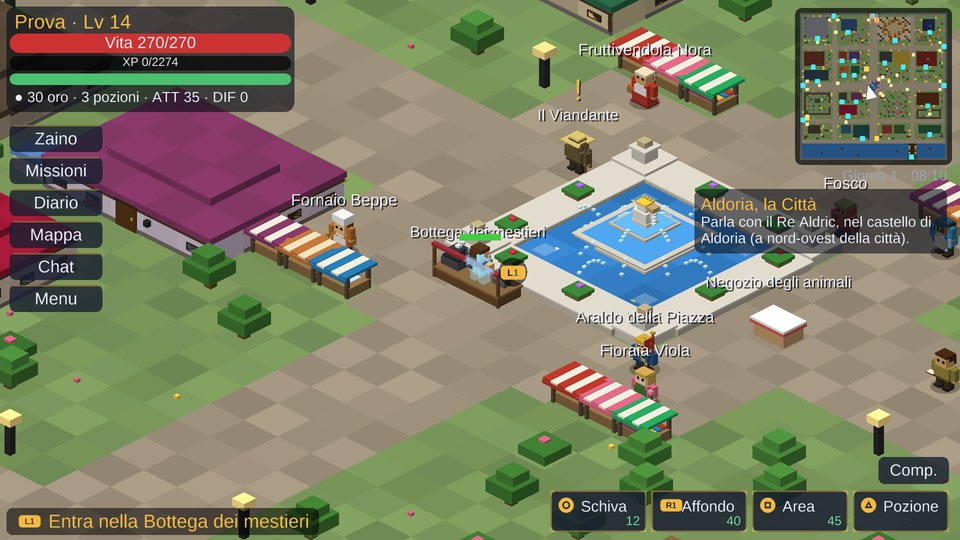
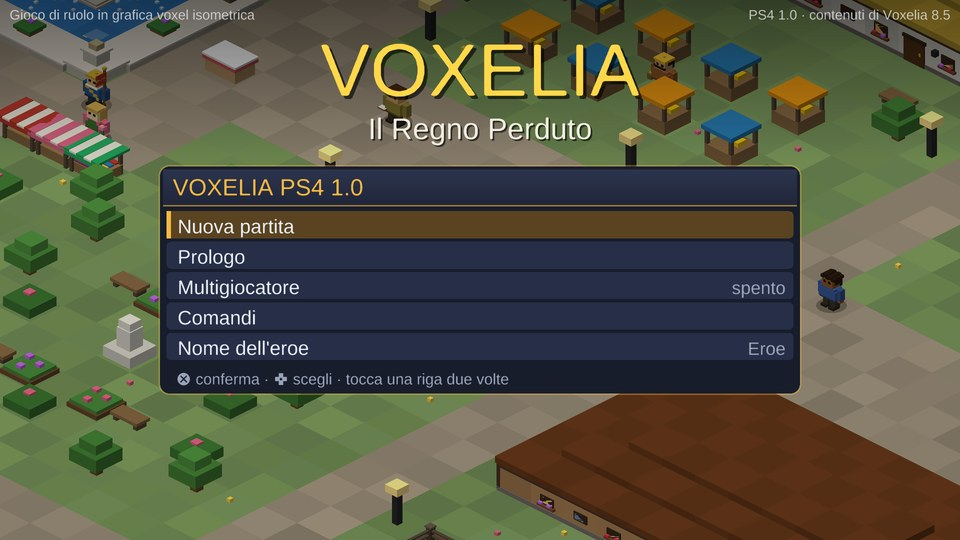
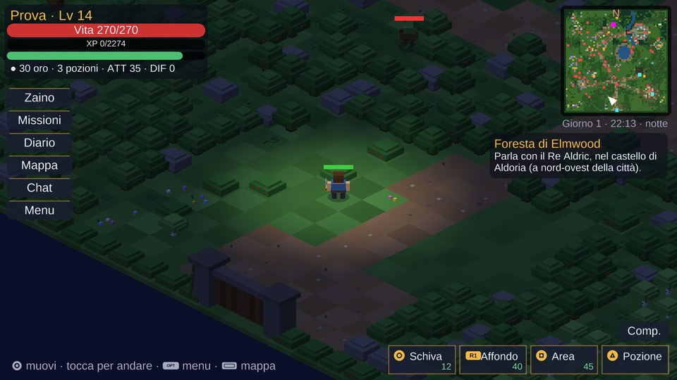
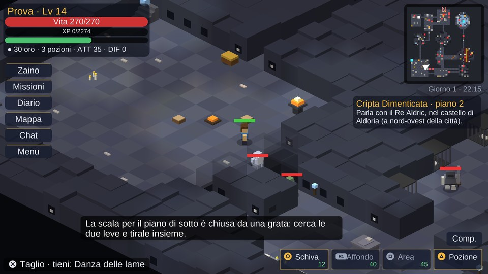
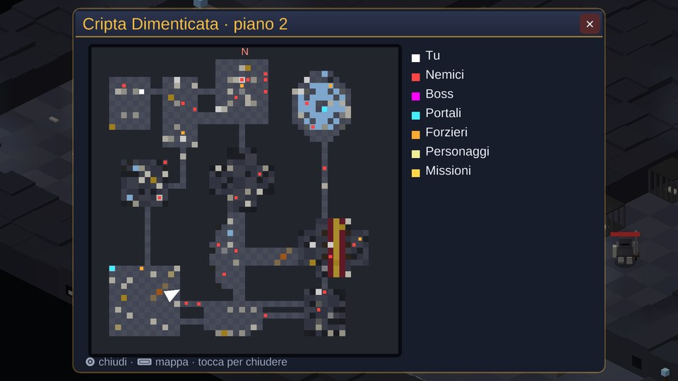
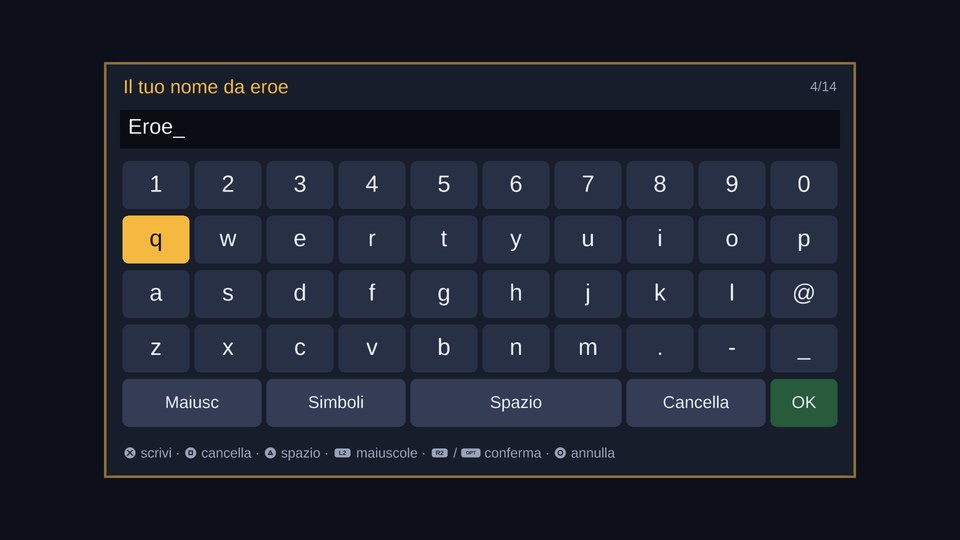
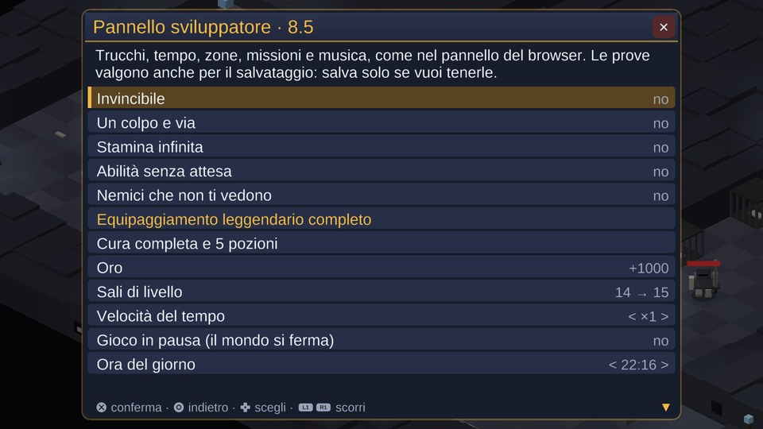

# Voxelia PS4 1.0 — Il Regno Perduto

Versione del port: **1.0** (contenuti di Voxelia **8.5**, le novità sono in [CHANGELOG.md](CHANGELOG.md)).

Port per **PlayStation 4** (homebrew, pacchetto PKG) di *Voxelia 8.5 – Il Regno Perduto*, il gioco di ruolo voxel
isometrico per browser. È un programma nativo in C fatto con la toolchain **OpenOrbis**, sul motore del port
PS Vita (nato a sua volta dal port 3DS): **1920x1080 a schermo intero, come il gioco per browser su un monitor**,
DualShock 4 con il **touchpad come mouse**, audio a 48 kHz, multigiocatore con il server di Voxelia.



| | |
|---|---|
|  |  |
|  |  |
|  |  |

## Installazione

1. Serve una PS4 con un firmware che permette gli homebrew (per esempio con **GoldHEN**) e il *Debug Settings*
   attivo, come per tutti i PKG homebrew.
2. Copia `voxelia.pkg` su una chiavetta USB (FAT32 o exFAT) e installalo con **Debug Settings → Game → Package
   Installer**, oppure con il *Package Installer* di GoldHEN o con *Remote Package Installer*.
3. Nella schermata principale compare **Voxelia** (ID `VXLA00001`).

I salvataggi vanno in `/data/voxelia/save.dat`, le impostazioni in `/data/voxelia/settings.dat`; in
`/data/voxelia/log.txt` c'è il registro dell'ultimo avvio (schermo, controller, audio, rete), utile se qualcosa
non va. La partita si salva da sola ogni 30 secondi e a ogni cambio di zona.

## Comandi

| Tasto | Azione |
|---|---|
| Levetta sinistra / croce direzionale | Muovi l'eroe (le direzioni dello schermo diventano quelle isometriche) |
| **Croce** | La mossa seguente della catena dell'arma (tre colpi per spada, pugnale, ascia, martello, lancia, tridente, bastone e falce). Ripremi quando la mossa finisce: «Perfetto!». Tienila premuta e lasciala: colpo caricato. Se il nemico è lontano l'eroe lo raggiunge. Senza nemici vicini, interagisci |
| **L1** | Interagisci: parla, apri forzieri, raccogli, entra nelle porte |
| **Cerchio** | Premi e lascia: capriola (invulnerabile per un attimo). Tieni premuto mentre ti muovi: corsa |
| **R1** | Affondo. Tenuto premuto: blocca il bersaglio (di nuovo: il seguente) |
| **Quadrato** | Colpo ad area |
| **Triangolo** | Pozione (cura il 35%, una ogni 2,5 secondi) |
| Levetta destra, **L2** / **R2** | Zoom (L2 allontana, R2 avvicina) |
| **OPTIONS** | Pausa: salvataggio, volumi, zoom, opzioni, multigiocatore, pannello sviluppatore |
| **Premi il touchpad** | Mappa grande della zona (e, quando compare un riquadro di un plugin, lo sceglie: Croce accetta, Cerchio rifiuta) |
| **Scorri il dito sul touchpad** | Muove il **puntatore**, come il mouse del browser |
| **Tocco leggero sul touchpad** oppure **R3** | Il clic del mouse: sul terreno l'eroe ci va da solo, su un nemico lo attacca, su una persona, un forziere, una porta o un oggetto ci va e lo usa. Clicca anche i pulsanti dell'interfaccia e le righe delle finestre |

**L'interfaccia è quella del browser, sopra il mondo**: in alto a sinistra l'eroe (vita, esperienza, stamina, oro,
pozioni, attacco e difesa), in alto a destra la minimappa con giorno e ora e sotto gli obiettivi della storia e
delle missioni; a sinistra i pulsanti Zaino, Missioni, Diario, Mappa, Chat e Menu; in basso a destra le abilità
(Schiva, Affondo, Area, Pozione) con stamina e ricariche, e sopra di loro Compagni, Doma e Sella.

Le finestre (dialoghi, negozi, fucina, zaino, missioni, diario, menu) si aprono al centro, con il mondo scurito
dietro. Si usano con croce direzionale e Croce, oppure con il puntatore. L1 e R1 scorrono le liste lunghe, sinistra
e destra cambiano volumi, zoom, puntate e velocità. Nello zaino, Quadrato getta a terra l'oggetto scelto.

Nel menu di pausa: **grandezza dell'interfaccia** (piccola, media, grande: da lontano dal televisore conviene la
grande), **clic sul terreno per muoverti** (si può spegnere), fotogrammi al secondo, nomi, numeri dei danni, ombre
e inseguimento automatico.

### La tastiera a schermo

Nome dell'eroe, chat, indirizzo del server e codice stanza si scrivono con una tastiera disegnata dal gioco:
croce direzionale o levetta per scegliere il tasto, **Croce** scrive, **Quadrato** cancella, **Triangolo** è lo
spazio, **L2** le maiuscole (una lettera), il tasto *Simboli* gli accenti e i segni, **R2** o **OPTIONS** conferma,
**Cerchio** annulla. I tasti si possono anche cliccare con il puntatore del touchpad.

## Cosa cambia rispetto al port Vita

La PS4 ha otto core x86-64 (AMD Jaguar a 1,6 GHz, sei per i giochi), 8 GB di memoria e un televisore a 1080p: il
port può mostrare il gioco come il browser su un monitor grande.

- **1920x1080 a schermo intero.** Il mondo si vede a 1080p con un quarto di mondo in più in larghezza rispetto alla
  Vita, alla stessa grandezza dei personaggi; l'interfaccia ha la stessa disposizione della Vita, il doppio dei
  pixel e tre grandezze pensate per il divano.
- **Disegno sugli otto core.** Per un homebrew la GPU della PS4 si usa solo attraverso Piglet (OpenGL ES) e il
  compilatore di shader della console, che senza patch del sistema non si può caricare: il port quindi disegna
  con un **rasterizzatore software a più thread** (`source/sw.c`). Fa quello che facevano gli shader della Vita —
  proiezione ortografica con depth buffer, luce ambiente e fino a 12 luci per vertice (lampioni, torce, fuochi,
  la luce dell'eroe), muri trasparenti davanti all'eroe e la sua sagoma dietro i muri, testo SDF nitido a ogni
  grandezza — dividendo lo schermo in fasce di righe tra sei thread. Ogni thread copia le sue righe finite nel
  buffer dello schermo di `sceVideoOut` (tre buffer, sincronizzati al ritorno verticale a 60 Hz).
  Funziona allo stesso modo su ogni firmware e non ha bisogno di file di sistema in più.
- **Il touchpad come mouse.** Il clic sul terreno del browser torna come puntatore, al posto dello schermo touch
  della Vita; la barra luminosa del controller si colora dell'oro di Voxelia.
- **Zoom con L2 e R2** (analogici) oltre alla levetta destra.
- **Audio a 48 kHz** in stereo (la frequenza della PS4), con lo stesso sintetizzatore e le stesse 96 voci.
- **Tastiera a schermo del gioco** al posto della tastiera di sistema della Vita.
- **Rete con sceNet**: socket e risolutore DNS della console, TLS con mbedtls 2.28 (incluso, si compila con il port).
- Il **pannello sviluppatore della 8.5** come sulla Vita.

## Contenuti: quelli della 8.5

Mappe, modelli, nemici, personaggi, missioni e musiche sono gli stessi file del port Vita, esportati direttamente
dalla versione browser 8.5: `tools/export.js` esegue `voxelia.html` in Node (jsdom, senza grafica), carica ogni
zona con il codice originale e registra ogni voxel che il renderer disegna, insieme a collisioni, luci ed entità;
poi cattura i fotogrammi dei modelli animati e compone l'eroe per ogni tipo d'arma, elmo, corazza e scudo.
`tools/songs.js` estrae i brani. Il carattere (`data/font.bin`) è rifatto per la PS4 da `tools/mkfont.py`, con i
simboli dei tasti del DualShock 4.

- **134 zone**: Aldoria con i quartieri, Foresta, Deserto, Picchi, Colosseo, 81 interni, Thalassa e la Giungla di
  Smeraldo, gli 8 dungeon con due varianti per piano (falò compresi, con la correzione della 8.3.2).
- **78 nemici e 14 boss**, **196 personaggi**, **130 missioni**, **70 brani** scritti più quelli procedurali.
- **La Modalità Storia del browser**: la difficoltà che cresce con te (8.3), i Campioni e i branchi, cavalli e
  corse, animali da compagnia, compagni domati, Serraglio, incroci e varianti, elementi ed Essenze, scelte, alleati
  e titoli, il regno oltre il mare, boss a fasi, armi che crescono, maledizioni, scavi, eventi a orario, diario
  delle scoperte, Bottega dei mestieri, Torre della Corona, duello delle carte, la riga dei prezzi della 8.3.1.

Per riesportare i dati da una versione nuova:

```bash
cd tools && VOXELIA_HTML=/percorso/di/voxelia.html ./aggiorna.sh
```

## Multigiocatore

Menu → **Multigiocatore** (anche dal titolo): codice stanza, server (di default quello ufficiale) e **Collegati**.
Il protocollo è quello di `server.js` (WebSocket su `/ws`, `wss://` con mbedtls), quindi chi gioca dalla PS4, dal
browser, dalla Vita, dal 3DS o dal DS con lo stesso codice stanza sta nello stesso mondo: gli altri eroi con
equipaggiamento, nome, livello, cavallo, animale e compagno; la chat e i fumetti; l'ora del mondo; i nemici
condivisi; l'arena PvP nel Colosseo; i plugin del server con la loro versione nativa (boss del mondo, caccia al
tesoro, taglie, teletrasporto, ritorno ad Aldoria, gruppi, emote, guardie e ladri...) e gli eventi generici per i
plugin nuovi. Con i plugin la PS4 si presenta come `{tipo: 'ps4'}`: chi scrive plugin trova tutto in
[PLUGIN.md](PLUGIN.md).

Provato con il `server.js` della 8.5 in locale: due giocatori (due copie della build per PC, che usa lo stesso
codice di rete tranne i socket) entrano nella stessa stanza, si vedono e si scrivono in chat in tutti e due i sensi.

## Compilare

Con Docker non serve installare niente (immagine ufficiale `openorbisofficial/toolchain`):

```bash
./build.sh          # -> voxelia.pkg
```

Con la toolchain OpenOrbis installata (`OO_PS4_TOOLCHAIN`), clang e ld.lld:

```bash
make                # build/voxelia.elf -> build/eboot.bin -> voxelia.pkg
make elf            # solo build/voxelia.elf
```

`make` compila anche mbedtls 2.28.8 dalle sorgenti in `third_party/` (licenza Apache 2.0) con la configurazione di
`third_party/mbedtls_ps4.h`, poi usa `create-eboot` e `PkgTool.Core` della toolchain per l'eboot e il pacchetto
(`tools/mkgp4.py` scrive il progetto del pacchetto). Content ID `IV0000-VXLA00001_00-VOXELIAPS4000001`.

### La build di prova per PC

`Makefile.pc` compila lo stesso gioco per Linux con SDL2 e mbedtls, con **lo stesso rasterizzatore software** e la
stessa immagine a 1920x1080 (la finestra è grande la metà; `VOX_WIN=1` per la grandezza vera): frecce/WASD muovi,
J Croce, K Cerchio, U Quadrato, I Triangolo, Q L1, E R1, +/- zoom, Invio OPTIONS, Tab touchpad, il mouse è il
puntatore. Serve per provare il port senza la console e per le prove automatiche: con `VOX_AUTO` il gioco esegue uno
script (`new; zone forest; stick 1 0 1; press A; shot immagine.ppm; allzones; quit` ...), anche senza finestra
(`VOX_HEADLESS=1`), che è come sono state fatte le immagini qui sopra e le prove di tutte le 134 zone, del
combattimento, dei dungeon, delle finestre, della tastiera a schermo e del multigiocatore, anche con
AddressSanitizer e UndefinedBehaviorSanitizer.

```bash
make -f Makefile.pc && ./voxelia_pc
```

Sul PC (un core Xeon a 2,1 GHz) un fotogramma di Aldoria a 1080p si disegna in circa 18 ms con un thread e 5-6 ms
con quattro: sui sei core Jaguar della PS4 il gioco va a 30-60 fotogrammi al secondo secondo la zona.

## Limiti

- **Non è ancora stato provato su una PS4 vera né in un emulatore**: il gioco è stato provato a fondo nella build
  per PC, che usa lo stesso codice (cambiano solo schermo, controller, audio e socket); il codice della console è
  compilato e collegato con la toolchain OpenOrbis contro le librerie di sistema. Se qualcosa non va, il registro è
  in `/data/voxelia/log.txt`.
- Come sul 3DS e sulla Vita, restano solo nel browser i capitoli del **vero finale** (la vecchia Aldoria, il culto,
  l'Occhio e i loro filmati), **Tomorrow**, **Voxelia Studio** e i mondi della community, il **Cuore della
  Corona**, la vista 3D e la realtà virtuale. Le missioni di pesca, tappe e battaglie non vengono proposte.
- Casa, Discoteca e Mercatino dei plugin hanno finestre del browser: dalla PS4 restano i loro comandi in chat.
- Niente tastiera USB né mouse: si scrive con la tastiera a schermo.

## Licenze

Il carattere è **Liberation Sans** (SIL Open Font License) con **DejaVu Sans** (licenza Bitstream Vera) per i simboli,
convertiti in `data/font.bin` da `tools/mkfont.py`. **mbedtls** è sotto licenza Apache 2.0
(`third_party/mbedtls-2.28.8-lib.tar.gz`, con il suo file LICENSE).
