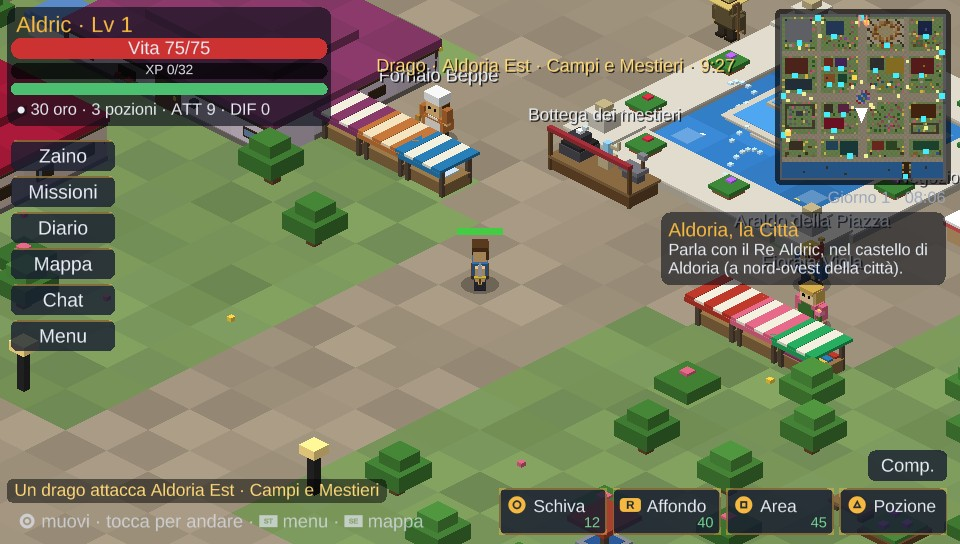
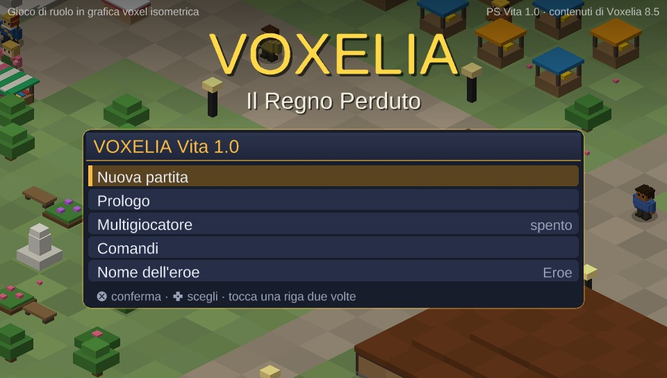
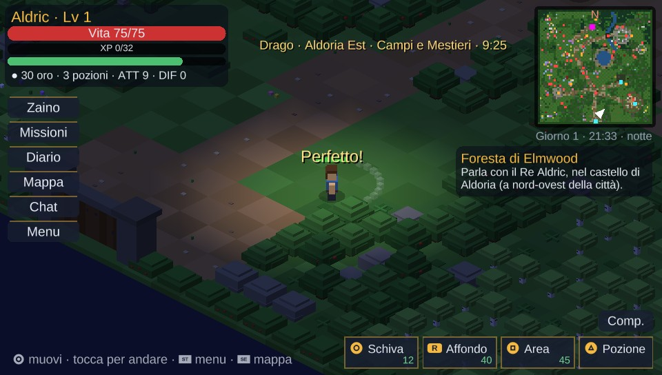
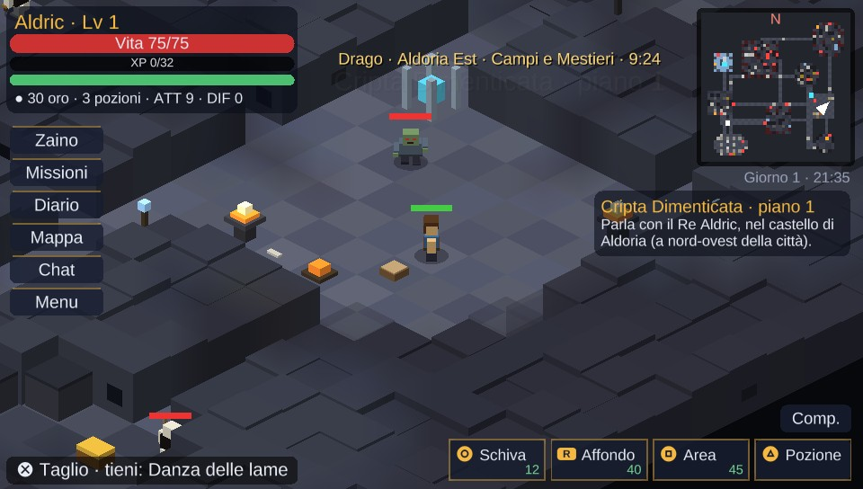
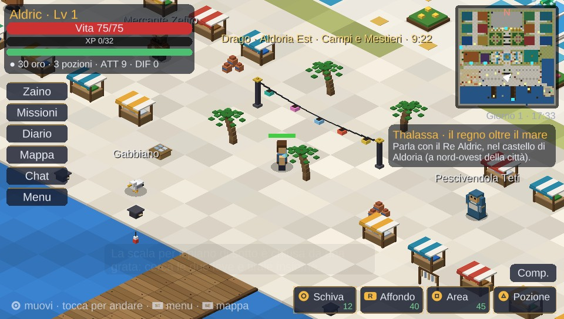
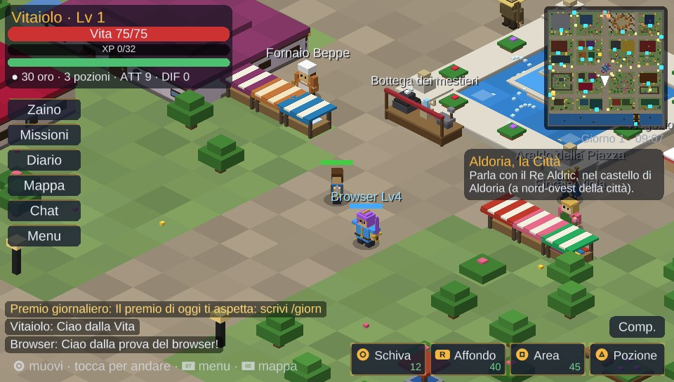
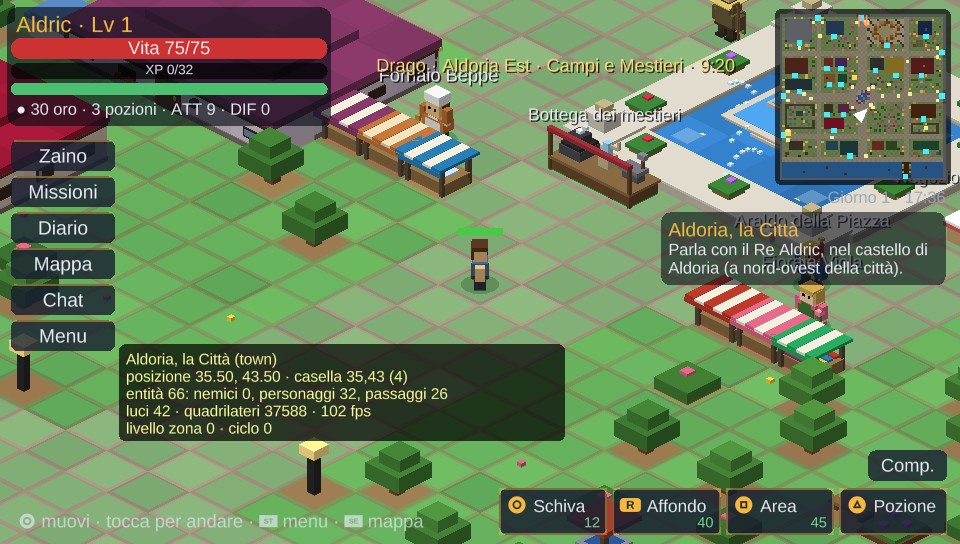

# Voxelia PS Vita 1.0.3 — Il Regno Perduto

Versione del port: **1.0.3** (contenuti di Voxelia **8.5**, le novità sono in [CHANGELOG.md](CHANGELOG.md)).

Port per **PlayStation Vita** (e PS TV) di *Voxelia 8.5 – Il Regno Perduto*, il gioco di ruolo voxel isometrico per
browser. È un programma nativo in C (VitaSDK + vitaGL), costruito sul motore del port 3DS ma pensato per la Vita:
**un solo schermo a 960x544 come il gioco per browser**, GPU con antialiasing, schermo touch, due levette e la
memoria per tenere in gioco tutto il mondo.



| | |
|---|---|
|  |  |
|  |  |
|  |  |

## Installazione

1. Serve una Vita (o PS TV) con HENkaku/Ensō e **VitaShell**.
2. Serve anche **`ur0:data/libshacccg.suprx`**, il compilatore di shader della console: vitaGL lo usa per gli
   shader del gioco. Quasi tutti gli homebrew in 3D lo richiedono; se manca, si estrae in un minuto con
   *ShaRKBR33D* (vedi la guida «Extract libshacccg.suprx» della Vita Troubleshooting Guide).
3. Copia `voxelia.vpk` sulla console e installalo con VitaShell. Compare la bolla **Voxelia** (ID `VXLA00001`).

I salvataggi vanno in `ux0:data/voxelia/save.dat`, le impostazioni in `ux0:data/voxelia/settings.dat`.
Ogni avvio scrive anche `ux0:data/voxelia/log.txt`: se il gioco si chiude, l'ultima riga dice dove si è fermato.
Se manca `libshacccg.suprx`, il gioco lo dice con un messaggio all'avvio.
La partita si salva da sola ogni 30 secondi e a ogni cambio di zona.

## Comandi

| Tasto | Azione |
|---|---|
| Levetta sinistra / croce direzionale | Muovi l'eroe (le direzioni dello schermo diventano quelle isometriche) |
| **Tocco sul terreno** | Come il clic del browser: l'eroe ci va da solo, scegliendo la strada. Toccando un nemico lo attacchi, toccando una persona, un forziere, una porta o un oggetto ci vai e lo usi |
| **Croce** | La mossa seguente della catena dell'arma (tre colpi per spada, pugnale, ascia, martello, lancia, tridente, bastone e falce). Ripremi quando la mossa finisce: «Perfetto!». Tienila premuta e lasciala: colpo caricato. Se il nemico è lontano l'eroe lo raggiunge. Senza nemici vicini, interagisci |
| **L** | Interagisci: parla, apri forzieri, raccogli, entra nelle porte |
| **Cerchio** | Premi e lascia: capriola (invulnerabile per un attimo). Tieni premuto mentre ti muovi: corsa |
| **R** | Affondo. Tenuto premuto: blocca il bersaglio (di nuovo: il seguente) |
| **Quadrato** | Colpo ad area |
| **Triangolo** | Pozione (cura il 35%, una ogni 2,5 secondi) |
| Levetta destra, oppure due dita sullo schermo | Zoom |
| START | Pausa: salvataggio, volumi, zoom, opzioni, multigiocatore, pannello sviluppatore |
| SELECT | Mappa grande della zona (e, quando compare un riquadro di un plugin, lo sceglie: Croce accetta, Cerchio rifiuta) |

**L'interfaccia è quella del browser, sopra il mondo**: in alto a sinistra l'eroe (vita, esperienza, stamina, oro,
pozioni, attacco e difesa), in alto a destra la minimappa con giorno e ora e sotto gli obiettivi della storia e
delle missioni; a sinistra i pulsanti Zaino, Missioni, Diario, Mappa, Chat e Menu; in basso a destra le abilità
(Schiva, Affondo, Area, Pozione) con stamina e ricariche, e sopra di loro Compagni, Doma e Sella. Tutto si tocca.

Le finestre (dialoghi, negozi, fucina, zaino, missioni, diario, menu) si aprono al centro, con il mondo scurito dietro.
Si usano con croce direzionale e Croce, oppure toccando: un tocco sceglie la riga, il secondo la conferma; la «×» in
alto chiude, come toccare fuori dalla finestra. L e R scorrono le liste lunghe, sinistra e destra cambiano volumi,
zoom, puntate e velocità. Nello zaino, Quadrato getta a terra l'oggetto scelto.

Nel menu di pausa: **grandezza dell'interfaccia** (piccola, media, grande), **tocca il terreno per muoverti**
(si può spegnere), fotogrammi al secondo, nomi, numeri dei danni, ombre e inseguimento automatico.

## Cosa cambia rispetto al port 3DS

La Vita ha una CPU quad-core Cortex-A9, una GPU SGX543MP4+ e 512 MB di memoria: il port non deve più rinunciare
a quello che il browser mostra.

- **Uno schermo come nel browser.** Sul 3DS il mondo stava in alto e tutto il resto sullo schermo touch. Sulla Vita
  c'è un solo schermo grande: l'HUD sta sopra il mondo come nel browser, le finestre al centro e si vede molto più
  mondo (il 33% in più in larghezza alla stessa grandezza dei personaggi).
- **Grafica a 960x544 con MSAA 4x.** Bordi dei voxel puliti, senza scalette.
- **Testo nitido a ogni grandezza.** Le scritte usano un atlante «signed distance field» (Liberation Sans e DejaVu
  Sans) con gli accenti, i simboli del gioco e quelli dei tasti della Vita.
- **Più luci.** Fino a 12 luci per vertice (il 3DS ne aveva 8) e un raggio più ampio: di notte e nei dungeon
  lampioni, torce e fuochi illuminano tutto lo schermo. Di giorno all'aperto si usa uno shader che calcola solo
  la luce ambiente.
- **Geometria più grande.** Fino a 200.000 quadrilateri fissi per zona in un vertex buffer della GPU (il 3DS ne
  teneva 76.000), divisi in blocchi di 8x8 caselle: si disegnano solo quelli inquadrati.
- **Tocca per muoverti**, **zoom con due dita** e **levetta destra**, come il mouse e la rotella del browser.
- **Audio a 44,1 kHz in stereo** (il 3DS suonava a 22 kHz), con lo stesso sintetizzatore e 96 voci.
- **Tastiera di sistema** della Vita per nome, chat, server e codice stanza.
- **Il pannello sviluppatore della 8.5**, che sul 3DS non c'è (vedi sotto).
- CPU a 444 MHz e GPU a 222 MHz, memoria estesa (`ATTRIBUTE2=12`).

## Contenuti: quelli della 8.5

Mappe, modelli, nemici, personaggi, missioni e musiche arrivano direttamente dalla versione browser 8.5:
`tools/export.js` esegue `voxelia.html` in Node (jsdom, senza grafica), carica ogni zona con il codice originale e
registra ogni voxel che il renderer disegna, insieme a collisioni, luci ed entità; poi cattura i fotogrammi dei
modelli animati e compone l'eroe per ogni tipo d'arma, elmo, corazza e scudo. `tools/songs.js` estrae i brani.

- **134 zone**: Aldoria con i quartieri, Foresta, Deserto, Picchi, Colosseo, 81 interni, Thalassa e la Giungla di
  Smeraldo, gli 8 dungeon con due varianti per piano (falò compresi, con la correzione della 8.3.2).
- **78 nemici e 14 boss**, **196 personaggi**, **130 missioni**, **70 brani** scritti più quelli procedurali.
- **La Modalità Storia del browser**, come nel port 3DS 1.6: la difficoltà che cresce con te (8.3), i Campioni e i
  branchi, cavalli e corse, animali da compagnia, compagni domati, Serraglio, incroci e varianti, elementi ed
  Essenze, scelte, alleati e titoli, il regno oltre il mare, boss a fasi, armi che crescono, maledizioni, scavi,
  eventi a orario, diario delle scoperte, Bottega dei mestieri, Torre della Corona, duello delle carte.

Per riesportare i dati da una versione nuova:

```bash
cd tools && VOXELIA_HTML=/percorso/di/voxelia.html ./aggiorna.sh
```

### Il pannello sviluppatore (8.5)

Menu di pausa → **Pannello sviluppatore**, come il 🛠 del browser:
- **Trucchi**: invincibile, un colpo e via, stamina infinita, abilità senza attesa, nemici che non ti vedono;
  equipaggiamento leggendario completo, cura e pozioni, oro, livello.
- **Tempo**: velocità da ×0,25 a ×8, pausa del mondo, ora del giorno, salto al giorno dopo.
- **Mondo**: qualunque zona del gioco (con i piani dei dungeon), tutti i brani da ascoltare.
- **Storia e missioni**: la fase della storia, le 130 missioni da accettare, completare o azzerare.
- **Debug**: la griglia delle collisioni sopra il mondo (verde libero, rosso chiuso, blu acqua), un riquadro con
  zona, posizione, casella, conteggi, luci, quadrilateri e fotogrammi, e **Prova questa zona** (passaggi,
  personaggi e nemici raggiungibili dall'eroe).

## Multigiocatore

Menu → **Multigiocatore** (anche dal titolo): codice stanza, server (di default quello ufficiale) e **Collegati**.
Il protocollo è quello di `server.js` (WebSocket su `/ws`, `wss://` con mbedtls), quindi chi gioca dalla Vita, dal
browser, dal 3DS o dal DS con lo stesso codice stanza sta nello stesso mondo: gli altri eroi con equipaggiamento,
nome, livello, cavallo, animale e compagno; la chat e i fumetti; l'ora del mondo; i nemici condivisi; l'arena PvP
nel Colosseo; i plugin del server con la loro versione nativa (boss del mondo, caccia al tesoro, taglie,
teletrasporto, ritorno ad Aldoria, gruppi, emote, guardie e ladri...) e gli eventi generici per i plugin nuovi.
Con i plugin la Vita si presenta come `{tipo: 'psvita'}`: chi scrive plugin trova tutto in [PLUGIN.md](PLUGIN.md).

Provato con il `server.js` della 8.5 in locale, in chiaro e con TLS: un giocatore «del browser» (un client di prova
con lo stesso protocollo) e la Vita si vedono con l'equipaggiamento e si scrivono in chat in tutti e due i sensi.

## Compilare

Con Docker non serve installare niente:

```bash
./build.sh          # -> build/voxelia.vpk
```

Con VitaSDK installato (servono i pacchetti `vitaGL`, `vitashark`, `mathneon` e `mbedtls`, tutti in `vdpm`):

```bash
mkdir build && cd build && cmake .. && make
```

### La build di prova per PC

`Makefile.pc` compila lo stesso gioco per Linux con SDL2, OpenGL 2.1 e mbedtls, con la stessa finestra di 960x544:
frecce/WASD muovi, J Croce, K Cerchio, U Quadrato, I Triangolo, Q L, E R, Invio START, Tab SELECT, +/- zoom,
il mouse fa da touch. Serve per provare il port senza la console e per le prove automatiche: con `VOX_AUTO` il gioco
esegue uno script (`new; zone forest town; stick 1 0 1; press A; shot immagine.ppm; allzones; quit` ...), che è
come sono state fatte le immagini qui sopra e le prove di tutte le zone, del combattimento, dei salvataggi e del
multigiocatore, anche con AddressSanitizer.

```bash
make -f Makefile.pc && ./voxelia_pc
```

## Limiti

- **Non è ancora stato provato su una Vita vera né in un emulatore**: il VPK si compila con VitaSDK e il gioco è
  stato provato a fondo nella build per PC, che usa lo stesso codice (cambiano solo grafica di sistema, tasti,
  audio e rete). Gli shader sono in GLSL semplice, che vitaGL traduce e compila sulla console.
- Come sul 3DS, restano solo nel browser i capitoli del **vero finale** (la vecchia Aldoria, il culto, l'Occhio e i
  loro filmati), **Tomorrow**, **Voxelia Studio** e i mondi della community, il **Cuore della Corona**, la vista 3D e
  la realtà virtuale. Le missioni di pesca, tappe e battaglie non vengono proposte.
- Casa, Discoteca e Mercatino dei plugin hanno finestre del browser: dalla Vita restano i loro comandi in chat.

## Licenze

Il carattere è **Liberation Sans** (SIL Open Font License) con **DejaVu Sans** (licenza Bitstream Vera) per i simboli,
convertiti in `data/font.bin` da `tools/mkfont.py`.
